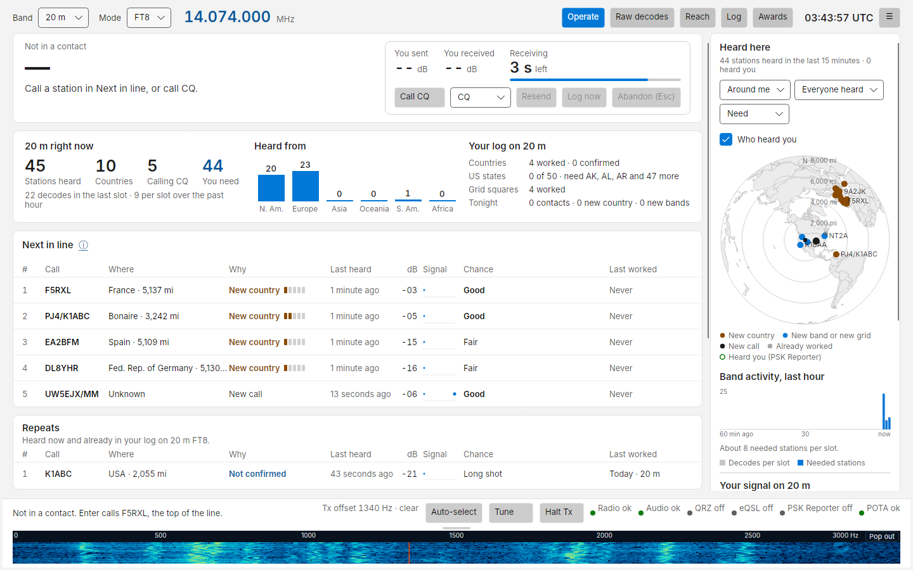
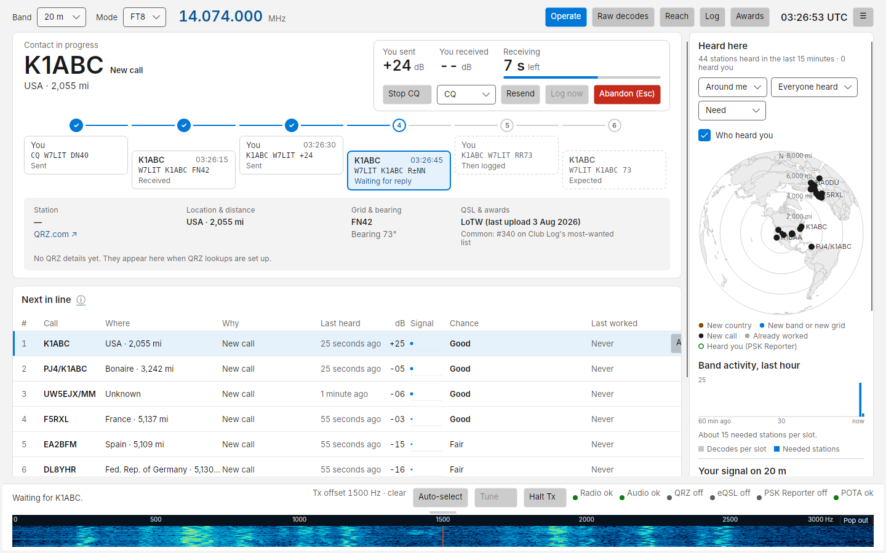
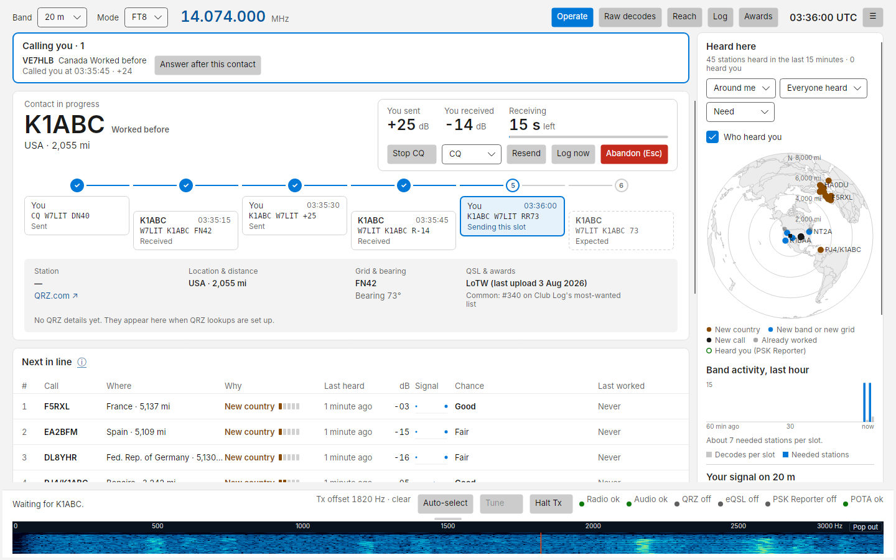
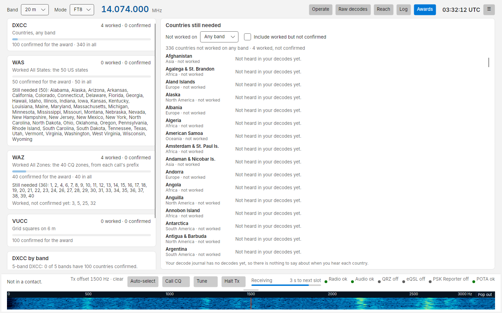
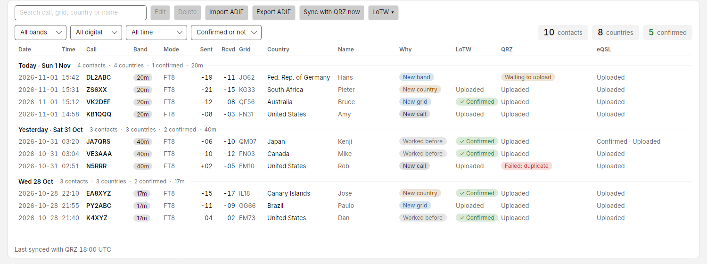

<p align="center"></p>

# Costas

**An FT8 and FT4 program for Windows that shows you stations, not messages.**

Costas uses the same decoder as WSJT-X, so it decodes as well and sounds identical on the air. What changes is the
screen: instead of a scrolling list of decoded lines, you get one row per station, ranked by what you need for your
log, whether the station is free to call, and whether it can hear you.

**[Website](https://somedudenamedtony.github.io/costas/)** ·
**[Read the user manual](https://somedudenamedtony.github.io/costas/introduction/)** ·
**[Download for Windows](https://github.com/somedudenamedtony/costas/releases/latest)** ·
**[Download for Linux (preview)](https://github.com/somedudenamedtony/costas/releases/latest)**



## Features

- **Next in line**: the stations you need, best first. New country, then new band, new grid, new call, worked out
  from your QRZ logbook.
- **Repeats**: stations on the air now that you have already worked on this band, with when and where you last
  worked them, one click to call them again.
- **Hears you and Chance**: from PSK Reporter, whether each station (or someone near it) hears your signal, and a
  Good / Fair / Long shot rating.
- **One-click contacts**: click **Call** or press Enter. Costas runs the standard exchange, shows each step on a
  progress strip, and logs the contact when it completes. Clicking **Call** on a recognised DXpedition Fox works it
  the Hound way automatically.
- **Calling you bar**: anyone who calls you is pinned above the list with an **Answer** button, and a station that
  replies after you gave up can be picked up again with **Resume**.
- **Hunt list**: the countries, calls, US states or grids you are after, with an alert when one is heard, on your
  band or (through PSK Reporter) any other. Alerts never transmit.
- **Logging and confirmations**: a local log with ADIF import and export, uploaded to your QRZ logbook, LoTW (through
  TQSL) and eQSL as you go, with confirmations synced back.
- **Awards**: DXCC, WAS, WAZ and VUCC progress from your own log, and when you usually hear each country you still
  need.
- **Maps**: who you hear (Heard here) and who hears you (Reach), centred on your grid, with band activity near you.
- **A waterfall you can size**: drag it taller in the main window or pop it out into its own window.
- **Mini mode and phone remote**: shrink Costas to a strip that stays on top, or operate from a phone or tablet on
  your home network.
- **Works with your other tools**: WSJT-X UDP for GridTracker, JTAlert and loggers; FLRig and network rigctld as
  well as direct Hamlib control.
- **Safe by design**: it never transmits on its own, never changes a message silently, and has a watchdog,
  band-edge check, clock check and PTT release on any fault.

<table>
<tr>
<td></td>
<td></td>
</tr>
<tr>
<td align="center">A contact in progress</td>
<td align="center">Someone calling you while you work another station</td>
</tr>
<tr>
<td></td>
<td></td>
</tr>
<tr>
<td align="center">Award progress and the countries you still need</td>
<td align="center">The log, with QRZ, LoTW and eQSL status</td>
</tr>
</table>

## Install

1. Download `CostasApp-win-Setup.exe` from the
   [latest release](https://github.com/somedudenamedtony/costas/releases/latest).
2. Run it. If Windows shows *Windows protected your PC* with *Publisher: Unknown publisher*, click **More info**,
   then **Run anyway**. Costas is not code-signed yet, so SmartScreen does not recognise it; the warning goes away
   once releases are signed.
3. Start Costas. Setup walks you through six steps: your station, radio, audio, a transmit test, a clock check and
   QRZ.

Requires 64-bit Windows 10 (1809) or later. The decoder (`jt9` from WSJT-X) and radio control (Hamlib) are
bundled; you do not need WSJT-X installed. Costas checks for new builds at start and daily and offers to install them, keeping
your log and settings; an update downloads only what changed, usually a few MB.

### Linux (preview)

1. Install the decoder, radio control and audio library from your distribution:
   `sudo apt install wsjtx libhamlib-utils libportaudio2 libsecret-tools` (Debian and Ubuntu names).
2. Download `Costas-<version>-linux-x64.tar.gz` from the
   [latest release](https://github.com/somedudenamedtony/costas/releases/latest), unpack it and run `./Costas`.

The Linux version receives and transmits FT8, FT4, PSK31, PSK63 and RTTY. It is still a preview because it has
not yet been used with a real radio on Linux: check your transmit audio level and ALC on your first contacts.
See [Install](https://somedudenamedtony.github.io/costas/install/#linux-preview) in the manual for details.

## Use it

1. Connect the radio by USB, tune to an FT8 frequency (14.074 MHz on 20 m) in USB or USB-D.
2. In setup, pick your radio model and press **Test connection**, then pick the radio's USB audio device and get the
   input level into the shaded band. Send the 2-second test tone into a dummy load.
3. Add your QRZ logbook API key so Costas knows what you have already worked.
4. Watch **Next in line**. Click **Call** on the top station, or press **Call CQ**.
5. Press **Esc** at any time to stop transmitting.

The [manual](https://somedudenamedtony.github.io/costas/) covers every screen and setting, with screenshots:
[setup](https://somedudenamedtony.github.io/costas/setup/),
[the Operate screen](https://somedudenamedtony.github.io/costas/operate/),
[making contacts](https://somedudenamedtony.github.io/costas/contacts/),
[maps](https://somedudenamedtony.github.io/costas/maps/),
[the log and QRZ](https://somedudenamedtony.github.io/costas/log/),
[the Hunt list](https://somedudenamedtony.github.io/costas/hunt/),
[awards](https://somedudenamedtony.github.io/costas/awards/),
[operating from a phone](https://somedudenamedtony.github.io/costas/phone/),
[settings](https://somedudenamedtony.github.io/costas/settings/) and
[troubleshooting](https://somedudenamedtony.github.io/costas/troubleshooting/).
Its source is in [`manual/`](manual/) if you prefer to read it here.

## Privacy

Costas sends anonymous usage statistics to [Aptabase](https://aptabase.com) so its developer can see how many people
use it and which features matter. It sends the Costas version, Windows or Linux, the band and mode, the kind of radio
connection and Hamlib model number, which optional features are on, and which views and actions you use. It never
sends your callsign, grid, name, frequencies, the stations you hear or work, or anything from your log, and there is no
account or tracking id. Nothing is sent while you are offline, in simulation, or from a build you make yourself.

To turn it off, untick **Settings › Privacy › Send anonymous usage statistics**. The full list is in
[the manual](https://somedudenamedtony.github.io/costas/settings/#privacy).

## Status

Costas is early software. Everything in the feature list is built and passes its automated tests (recorded audio,
a simulated radio and Hamlib's test radio), but it has had little on-air use yet. Use low power or a dummy load at
first and keep an eye on the radio. Problems and ideas: [GitHub Issues](https://github.com/somedudenamedtony/costas/issues).

## For developers

C# on .NET 10 with Avalonia 12. WSJT-X's `jt9` decodes and Hamlib's `rigctld` controls the radio, both as supervised
child processes. Rules for working on the code are in [`CLAUDE.md`](CLAUDE.md); the design is in [`docs/`](docs/):

| File | What it holds |
| --- | --- |
| [`docs/01-product-spec.md`](docs/01-product-spec.md) | Goals, users, scope, feature list by release |
| [`docs/02-ui-spec.md`](docs/02-ui-spec.md) | Every screen, component, state, keyboard shortcut and design token |
| [`docs/03-architecture.md`](docs/03-architecture.md) | Solution layout, components, threading, process model, simulation mode |
| [`docs/04-domain-logic.md`](docs/04-domain-logic.md) | Message parsing, station tracking, need tiers, ranking, contact state machine, transmit encoding |
| [`docs/05-integrations.md`](docs/05-integrations.md) | jt9, Hamlib, QRZ, PSK Reporter, WSJT-X UDP, time check, update check |
| [`docs/06-data-model.md`](docs/06-data-model.md) | SQLite schema, settings, files on disk, ADIF mapping |
| [`docs/07-milestones.md`](docs/07-milestones.md) | Build order, M0 to M13, with acceptance tests |
| [`docs/08-open-questions.md`](docs/08-open-questions.md) | Decisions assumed, facts not yet verified, known risks |
| [`docs/09-keyboard-modes.md`](docs/09-keyboard-modes.md) | PSK31, PSK63 and RTTY on the same Operate screen (planned) |
| [`docs/09-next-up.md`](docs/09-next-up.md) | Proposed next features and fixes, for the owner to pick from |
| [`mockups/`](mockups/) | The original approved screen designs |

### Build and run from source

```
third_party/fetch.sh            # or: pwsh third_party/fetch.ps1 on Windows (needs 7-Zip); fetches jt9 and Hamlib
dotnet build
dotnet test
dotnet run --project src/Ft8Client.App -- --simulate samples/ft8 --simulate-partner
```

The last line replays the sample recordings with a simulated station that answers your calls, so you need no radio.
Simulation never keys a radio, never uploads spots and does not write the decode journal or WAV files. Without
`--simulate` and with no radio set up, the app shows no data. `scripts/build-installer.ps1` builds the installer
locally.

Developer mode (hidden): in About, click the product name seven times. Settings then has a Developer section, and
Setup lists Hamlib's test radio ("Hamlib Dummy"), which runs the real `rigctld` path with transmit audio muted.

### Build status

Built through milestone M7, with FT4 receive and transmit from M8. Every automated acceptance test in
`docs/07-milestones.md` up to M7 passes. CI builds and tests on Linux and Windows, builds the installer, and
publishes a GitHub Release when the owner runs the CI workflow on `main` by hand (Actions > CI > Run workflow).

| Milestone | Automated | Still to do by hand or not built |
| --- | --- | --- |
| M0 skeleton, decode harness | Golden decodes for every sample through `jt9` | Windows DLL set for `jt9.exe` (V2) |
| M1 core domain | Parser, tracker, need tiers, ranking, country lookup | — |
| M2 log and QRZ | ADIF round trip, fake QRZ server; real read-only sync of the owner's logbook checked (396/396) | — |
| M3 receive, Operate (idle) | Slot clock, simulation, screen checked against the mockup under Xvfb | Live audio on Windows (WASAPI) |
| M4 radio and transmit | 53 FT8 + 53 FT4 vectors against `ft8code`/`ft4code`; waveform decodes through `jt9`; guards; `rigctld` crash recovery | On-air transmit with an IC-7300 |
| M5 contacts | Contact engine rules; ten simulated partner contacts end to end | On-air contacts |
| M6 PSK Reporter | IPFIX byte for byte; feed against a local broker incl. reconnect and de-dupe; query fallback | Live MQTT subscription (V7); spot upload seen on pskreporter.info |
| M7 setup, settings, log, interop | UDP datagrams for every type; settings migration; secrets kept out of settings, logs and the bundle | GridTracker on Windows; first-run timing with an IC-7300 |
| M8 FT4, hardening, release | FT4 vectors and decode round trip; user manual | 24-hour soak, code signing |
| M10 PSK31 and PSK63 receive (feature branch) | Demodulators against generated signals in noise; synthetic recordings with three stations; stations found from text | Real recordings against fldigi (V25); transmit is M12 |
| M11 RTTY receive (feature branch) | Demodulator with ATC against noise, fading, one lost tone and Reverse; synthetic recordings (busy, fading, reversed) | Real recordings against fldigi or MMTTY (V25); transmit is M12 |
| M12 PSK and RTTY transmit and contacts (feature branch) | Modulators read back by our demodulators; watchdog, fault and Halt PTT release; both contact flows; a whole PSK31 contact logged; RTTY power cap; PSK zero-ALC level | Contacts on the air with the owner's radio; LoTW confirmation |
| M13 Keyboard modes everywhere else (feature branch) | PSK Reporter spots and WSJT-X UDP status (V23, V24 from fldigi and GridTracker source); macro keys in Mini mode and on the phone; Mode filters in Log and Awards; AFC switch; missing macro fields in red | A spot seen on pskreporter.info; a Status seen in GridTracker |

### Test builds

Every CI run builds a Windows installer and keeps it for 90 days as the run's **Costas-Setup** artifact, on any
branch. Only a manual run on `main` publishes a release, so a test build never reaches installed apps, and only
release builds carry the usage-statistics key. To try a branch (the PSK and RTTY work on `feature/keyboard-modes`,
say): Actions > CI > Run workflow, pick the branch, wait for the green tick, open the run and download
**Costas-Setup** from Artifacts (signed in to GitHub). Unzip it and run `Costas-Setup-<version>.exe`; it installs over
the current Costas and keeps settings and the log. A test build is numbered from the same run counter, so the next
release from `main` is newer and the app offers it as usual, which also takes the machine back to `main`.

### The manual

The user manual is in [`manual/`](manual/), built with MkDocs Material and published to GitHub Pages by
[`.github/workflows/manual.yml`](.github/workflows/manual.yml) on every push to `main`. Preview it with
`pip install -r manual/requirements.txt && mkdocs serve`.

## Credits and licence

Costas is free software under the [GNU General Public License, version 3](LICENSE) or later, because it ships and
runs the WSJT-X decoder.

- Decoding by `jt9` from [WSJT-X](https://wsjt.sourceforge.io/) (K1JT, K9AN, G4WJS and the WSJT Development Group), GPLv3.
- Rig control by [Hamlib](https://hamlib.github.io/), LGPL.
- Transmit encoder ported from [ft8_lib](https://github.com/kgoba/ft8_lib) by Kārlis Goba, MIT.
- Country file `cty.dat` by Jim Reisert AD1C, [country-files.com](https://www.country-files.com/).
- Reception reports from [PSK Reporter](https://pskreporter.info/) (Philip Gladstone, N1DQ) and its MQTT feed by
  M0LTE. Logbook and lookups by [QRZ.com](https://www.qrz.com/).

Owner: Tony Shepherd, W7LIT. The product name lives in one constant, `AppInfo.ProductName`; the code namespace is
`Ft8Client`.
