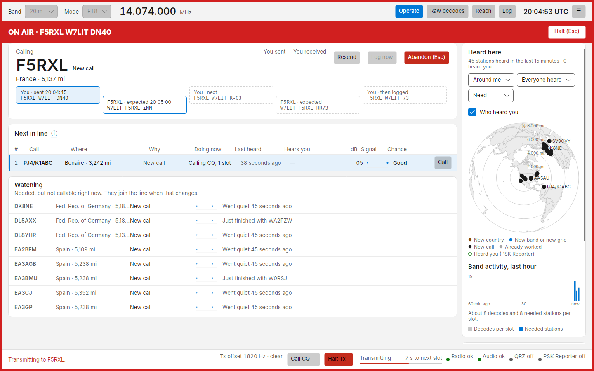
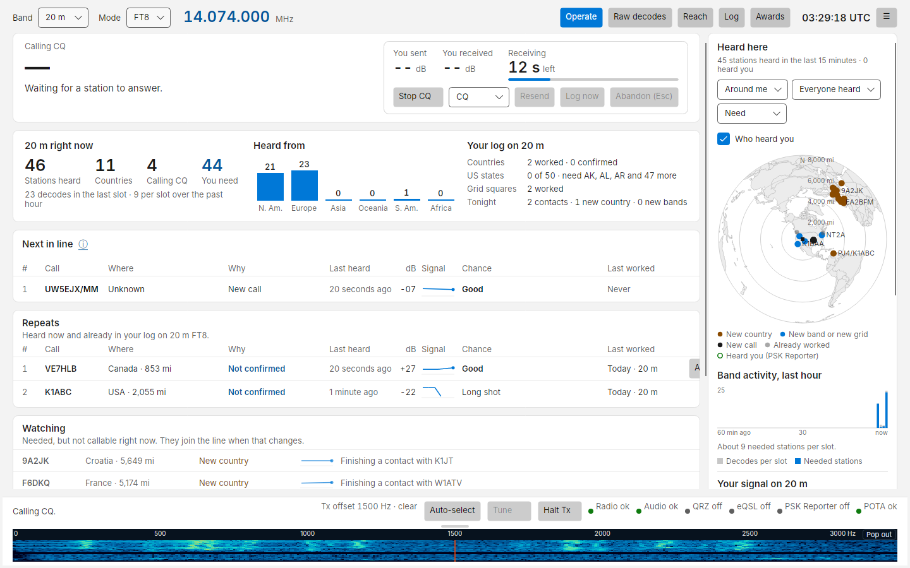
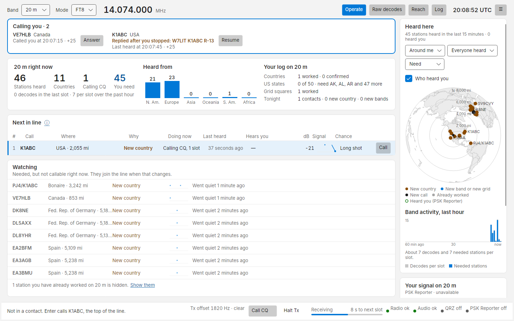

# Making contacts

Costas runs the standard FT8 exchange for you, the same messages WSJT-X sends, so other stations cannot tell the
difference. You start every contact; Costas never calls anyone on its own.

## Calling a station

Pick a station in **Next in line** and click **Call** (or double-click it, or select it and press ++enter++).
You can also double-click a CQ in [Raw decodes](raw-decodes.md).

The top card becomes the contact panel, and the red **ON AIR** banner shows while you transmit:



| Part | What it shows |
| --- | --- |
| Caption | *Calling*, then *Contact in progress*, then *Logged* (or *Abandoned*, *No reply*, *In another contact*) |
| Callsign and need tag | Who you are working, and why you wanted them |
| Subline | Name from QRZ (once the lookup arrives), country or state, distance |
| **You sent** / **You received** | The signal reports, as they are exchanged |
| **Resend** | Sends the current step again in your next slot. ++ctrl+r++ |
| **Log now** | Logs the contact as it stands. Enabled once both reports are exchanged. ++ctrl+l++ |
| **Abandon (Esc)** | Stops transmitting and ends the contact without logging it |

### The conversation strip

Under the callsign, five boxes show the exchange. Yours sit higher, theirs lower:


| Box | Means |
| --- | --- |
| Solid tinted | Done: *You · sent 20:04:45* or *F5RXL · received 20:05:00*, with the message |
| Red | Sending now, with seconds left |
| Outlined | What Costas is waiting for, and when it is expected |
| Dashed | Still to come |
| ×2 | That step was sent or received more than once |

If you need to jump ahead or back, click one of **your** upcoming boxes: Costas sends that message next.

A typical contact answering a CQ:

1. You: `F5RXL W7LIT DN40` (your grid, unless you turned **Send my grid** off)
2. Them: `W7LIT F5RXL -13`
3. You: `F5RXL W7LIT R-03`
4. Them: `W7LIT F5RXL RR73`. The contact is logged (and uploaded to QRZ) at this point.
5. You: `F5RXL W7LIT 73`, sent once as a courtesy (or `RR73`, see **Last message when answering** in
   [Settings](settings.md#transmitting)).

When the other station does not answer, Costas tries again, and gives up after the number of tries set in
**Settings › Transmitting › Give up after** (4 by default). If they repeat themselves, Costas steps back and resends
what they missed.

If the station you called answers someone else before it has replied to you (it sends its report or grid to another
call), Costas stops calling it straight away. The panel shows *In another contact* for one slot with the reason under
the callsign, for example *F5RXL answered K1ABC instead. Stopped calling.* If you call a station that is already
exchanging reports with someone else, Costas sends nothing and the panel says *F5RXL is in a contact with K1ABC. Not
calling.* If they come back to you within 5 minutes, they
show in the Calling you bar with a **Resume** button, as below. A station that only signs off an earlier contact
(RR73, 73) or calls CQ again does not end your call.

After logging, the panel shows *Logged* for one slot and then goes back to the band summary. The station drops out
of Next in line (it is now worked on this band) and your tallies update:



### Answering a contest CQ

Stations calling `CQ FD` (Field Day), `CQ RU` (FT Roundup), `CQ WW` (WW Digi) or `CQ TEST` (the ARRL Digital contest
and NA VHF) can be called like anyone else, as long as Costas can send the exchange that contest needs. Costas sends
exactly what WSJT-X sends: your exchange straight away instead of your grid call, then **RR73** once they send theirs
with an R, and the contact is logged with the contest and both exchanges.

```
CQ FD K1ABC FN42
                       K1ABC W9XYZ 6A WI
W9XYZ K1ABC R 2B EMA
                       K1ABC W9XYZ RR73
```

Set your Field Day class and section and your Roundup state, province or DX in
[Settings › Station](settings.md#station). Until then those stations wait in Watching and say what is missing.
Other contests (the EU VHF contest, Winter Field Day, WPX) and contests with a compound call are not answered, because
FT8 has no message that would carry their exchange correctly.

### Compound and portable calls

Costas works stations with a prefix or long suffix, such as **PJ4/K1ABC**, and you can use one as your own call
(**VE3/W7LIT**) in **Settings › Station**. FT8 can carry such a call in full only in a short message, so Costas sends
the same messages WSJT-X does: the compound call is shortened to a code (shown in angle brackets, `<PJ4/K1ABC>`) in
messages with a grid or report, and sent in full in the sign-off. With a compound call of your own, your CQ and your
answer to a CQ carry no grid, and a CQ modifier such as DX cannot be added (Settings says so). Two compound calls
cannot work each other over FT8; Costas refuses to send rather than change a message.

## Calling CQ

Click **Call CQ** (or press ++ctrl+q++). Costas calls CQ in the parity set in **Settings › Transmitting › Call CQ in**
(even or odd slots) until you click **Stop CQ**.

To call a part of the world, pick it in the dropdown beside **Call CQ**: **CQ** for everyone, **CQ DX** for stations
outside your country, **CQ NA**, **CQ EU** and the other continents, or **CQ POTA**. It applies from your next CQ,
and is the same setting as **Settings › Transmitting › CQ**.

When someone answers, Costas starts the contact with the first caller. Anyone else who calls you meanwhile waits in
the **Calling you** bar.

## The Calling you bar

When a station calls you and you have not answered, a bar is pinned above the top card, outside the scrolling area,
so you cannot miss it:


Each caller shows callsign, where, need tag and *Called you at 20:07:15 · +25*. Up to 5 callers, oldest first.

- While you are in a contact the button reads **Answer after this contact**. Click it and Costas answers that
  station as soon as the current contact ends (the button then reads *Will answer after this contact*).
- When you are not in a contact it reads **Answer** and answers in your next slot.

The same station also appears in Next in line with *Calling you* under Doing now and an **Answer** button, which does
the same thing.

**Chime**: **Settings › Transmitting › Calling you › Chime when a new station calls me** plays a short sound when a new
caller appears. It is off by default. It plays on the computer's default speakers, and stays silent if the default
device is the radio's audio device, so it can never go out over the air.

### Late replies and Resume

If you stop a contact (Abandon, Halt, or it ended with no reply, by the watchdog or because they answered someone else) and that station then replies
within 5 minutes, it shows in the bar with *Replied after you stopped: W7LIT K1ABC R-13* and a **Resume** button:



Nothing is sent until you press **Resume**. Resume picks the contact up where it was, as if their late message had
arrived in time: a late RR73 logs the contact and sends 73, a late report gets your R-report.

## Working a DXpedition (Fox/Hound)

Many DXpeditions run **Fox/Hound**: the DXpedition (the Fox) transmits below 1000 Hz, in the first slot of each pair,
and works several callers (Hounds) at once. Hounds call above 1000 Hz and must follow its rules, or the Fox never
hears them. Costas spots a Fox when it sends a multi-answer message such as `K1ABC RR73; W7LIT <KH1X> -12`, and
shows it in Next in line as *DXpedition (Fox/Hound), working Hounds*. There is nothing to switch on:

1. Tune the radio to the DXpedition's frequency (they usually announce it; it is rarely the standard FT8 one).
2. Click **Call** on the Fox. Costas works it the way WSJT-X's Hound mode does, and every other station as usual:

| Step | Who | Message | |
| --- | --- | --- | --- |
| 1 | You | `KH1X W7LIT DN40` | Repeated on your own offset, always 1000 Hz or more |
| 2 | Fox | `W7LIT KH1X -12`, or `K1ABC RR73; W7LIT <KH1X> -12` | |
| 3 | You | `KH1X W7LIT R-08` | On the **Fox's** frequency; the report is how strong the Fox was when it answered you |
| 4 | Fox | `W7LIT KH1X RR73`, or `W7LIT RR73; K1ABC <KH1X> -12` | Logged. You send nothing after it |

- If the Fox doesn't answer within 2 minutes, Costas stops calling and says so. Click **Call** again to keep trying,
  as WSJT-X asks you to re-enable Tx every 2 minutes.
- Once the Fox has sent your report, Costas keeps sending R-reports until its RR73 arrives, for up to 11 slots
  after its latest report.
- A Fox is always working someone, so Costas doesn't stop calling it when it answers other Hounds.
- Until the Fox has sent a multi-answer message, Costas can't tell it is a Fox and calls it the ordinary way.
  Fox/Hound DXpeditions send them nearly every slot, so this is rarely more than a moment.
- Your R-report goes out below 1000 Hz. On some radios very low audio lets harmonics through; keep the transmit
  audio clean (the automatic level helps), and watch the ALC warning.
- **SuperFox** DXpeditions (WSJT-X 2.7's SuperHound mode) can't be worked yet: their signal needs a decoder that
  Costas can't run until it keeps `jt9` running between slots.

### SuperFox DXpeditions

Many DXpeditions now run SuperFox, one wide signal that carries all their replies and that the normal FT8 decoder cannot
read. Costas searches every other FT8 slot for one (Settings › Transmitting › SuperFox) and lists the DXpedition like
any Fox. Click **Call** and it is worked the SuperHound way automatically: your calls go at 1000 Hz or above, your
R-report stays on your own frequency, and the contact is logged on the Fox's RR73. The search needs the WSJT-X 3.0
decoder that Costas installs on Windows.

## Halting

**Halt Tx** in the bottom bar, **Halt (Esc)** in the ON AIR banner, and the ++esc++ key all drop PTT immediately and
stop the sequence.

In a contact, the first ++esc++ stops transmitting. Once both reports have been exchanged, Costas asks you to press
++esc++ a second time before it abandons the contact, so a stray key press does not lose a nearly complete contact.

## Safety guards

These are always on:

| Guard | What happens |
| --- | --- |
| **Watchdog** | If you have not touched the app (key or click) for 6 minutes (**Settings › Transmitting › Watchdog**), transmitting stops: *Stopped by watchdog* |
| **Clock** | Transmitting is refused while your clock is off by more than 2 s (**Clock limit**) |
| **Band edge** | Costas will not transmit outside the band's limits for the dial frequency and offset |
| **Faults** | Any radio or audio error releases PTT at once |
| **No radio** | With no radio set up, transmit is refused and the radio indicator says why |
| **Exact messages** | If a message cannot be encoded exactly as shown (for example an unusual callsign or a free text with characters FT8 cannot carry), Costas refuses to send it and says why, rather than changing it |
| **Meters** | After each transmission, a high SWR (2 or more, red at 3) or ALC reading shows a warning in the bottom bar with advice |

## Logging

With **Settings › Transmitting › Logging › Log each contact automatically when it completes** on (the default),
contacts are logged when the exchange completes. Otherwise use **Log now**. Either way the contact goes to the local
log and, if set up, to your QRZ logbook. See [Log, QRZ and ADIF](log.md).
