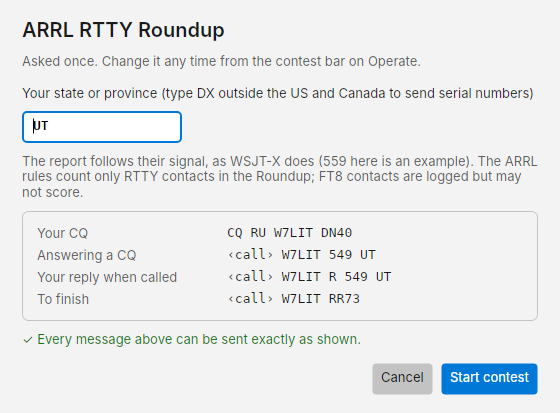
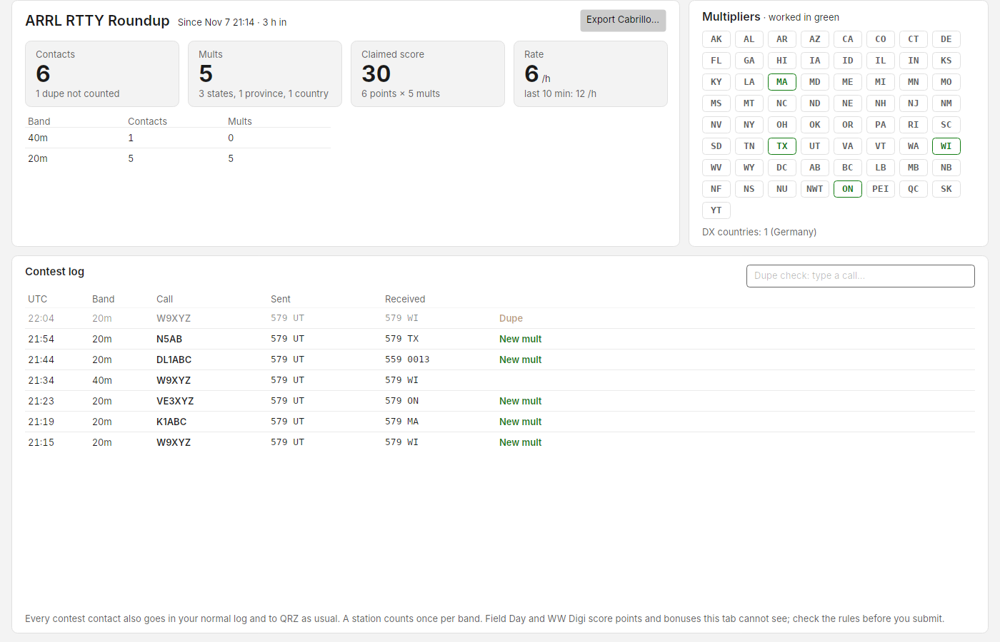

# Contests

Costas can run four FT8 and FT4 contests. You work contacts on the Operate screen as usual; the contest changes what
you send and adds a **Contest** view with your score.

| Contest | CQ | You send |
| --- | --- | --- |
| ARRL RTTY Roundup | `CQ RU` | A report and your state or province (`559 UT`), or a serial number if you are outside the US and Canada |
| ARRL Field Day | `CQ FD` | Your class and section (`1D UT`) |
| WW Digi | `CQ WW` | Your grid (`DN40`) |
| ARRL Digi | `CQ TEST` | Your grid (`DN40`) |

!!! warning "The RTTY Roundup counts RTTY contacts only"
    The ARRL's Roundup rules list RTTY as the only mode. Many stations use the Roundup messages on FT8 that weekend,
    and Costas logs those contacts, but they may not score. Roundup support in Costas's real RTTY mode is planned.

## Starting a contest

1. On Operate, open the dropdown beside **Call CQ** and pick the contest under **Contest (changes the exchange)**.
2. The first time, Costas asks for your exchange: your state or province (type **DX** if you are outside the US and
   Canada, and Costas sends serial numbers), or your Field Day class and section. WW Digi and ARRL Digi send the grid
   from Settings and ask nothing.
3. The sheet shows every message the contest will send. **Start contest** is only enabled when every one of them can be
   sent exactly as shown.

An amber **CONTEST** bar now runs across the top of Operate with what you are sending, your contacts, multipliers and
dupes. **Change exchange** opens the sheet again; **End contest** goes back to normal CQs and reports. Picking a plain
CQ in the dropdown ends the contest too.

Picking the same contest again within four days carries on the same contest log. After that it starts a new one.

## Working contacts

Click **Call CQ** to call `CQ RU W7LIT DN40` (with your call and grid), or click **Call** on a station calling a contest
CQ. Contest CQs are callable only while you have that contest picked; otherwise they wait in Watching.

The sequence is the one WSJT-X uses:

- **Answering a CQ:** you send your exchange, they send `R` and theirs, you send `RR73` and the contact is logged.
- **Running:** you call CQ, a caller sends their exchange, you send `R` and yours, their `RR73` logs the contact, and
  you send `73` once.

The Roundup report follows their signal strength (`5`, then 2 to 9, then `9`), as in WSJT-X.

During a contest contact the card shows **You sent** and **They sent** with the exchanges. In Next in line, **New mult ·
MA** in green marks a station that adds a multiplier (they are listed first), and a station you have already worked
in the contest on this band moves to Worked as a **Dupe**.

## The Contest view

The **Contest** tab (++ctrl+6++) appears beside Awards while a contest is picked, with its CQ in an amber badge.

- **Contacts, Mults, Claimed score and Rate** (contacts in the last hour, and the rate over the last 10 minutes).
- A table of contacts and multipliers by band.
- **Multipliers**: for the Roundup, every state and province with the ones you have worked in green, and the DX
  countries; for WW Digi, the grid fields worked on each band.
- **Contest log**, newest first, with New mult and Dupe tags.
- **Dupe check**: type a call to see whether it is a dupe on the band you are on.
- **Export Cabrillo…** saves the contest log as a Cabrillo file to upload to the sponsor. Dupes are included, as the
  sponsors ask. Check the category lines in the file (single operator, all bands, your power from Settings) before
  you send it.

The score is Costas's estimate. Field Day power multipliers and bonus points are not included, and the sponsor's log
check decides the real score.

Every contest contact also goes in your normal log, to QRZ and LoTW as usual, with the contest name and both exchanges
in the ADIF fields loggers use (`CONTEST_ID`, `STX_STRING`, `SRX_STRING`).
