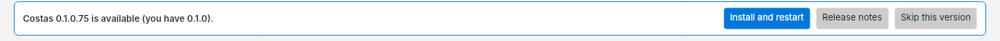

# Install

## Download

1. Open the [Releases page](https://github.com/somedudenamedtony/costas/releases/latest).
2. Under **Assets**, download `Costas-Setup-<version>.exe`.
3. Run it. The installer does not need administrator rights: by default it installs for your user only. It can
   add a desktop shortcut if you tick the box.

Everything Costas needs is in the installer: the WSJT-X `jt9` decoder and Hamlib's `rigctld` for radio control are
bundled. You do not need WSJT-X installed.

!!! warning "Windows SmartScreen"
    The installer is not code-signed yet, so Windows may show *Windows protected your PC*. Click **More info**, then
    **Run anyway**. Each release also has a `.sha256` file if you want to check the download.

Requirements: 64-bit Windows 10 (version 1809) or later, or Windows 11.

## Updates

Costas checks GitHub for a newer build when it starts and then once a day. When one is available, a bar
appears at the top of the main window:

- **Install and restart** downloads the new installer, checks its SHA-256 checksum, closes Costas and upgrades in
  place. It is refused while you are transmitting or in a contact: finish or halt first.
- **Release notes** opens the release on GitHub.
- **Skip this version** hides the bar until a newer build comes out.

You can turn the daily check off, or check by hand, in **Settings › Updates**. **☰ › About** also has a **Check for updates** button, which checks even when the daily check is off.

Upgrading keeps your log and settings. An install from before the rename (when the app was called "FT8 Client") is
upgraded too, and its data is moved to the Costas data folder on first start.

## Where your data lives

| What | Where |
| --- | --- |
| Log, settings, decode journal, saved audio | `%LOCALAPPDATA%\Costas\` (for example `C:\Users\you\AppData\Local\Costas\`) |
| QRZ API key and password | Windows Credential Manager, never in a file |
| The program | `%LOCALAPPDATA%\Programs\Costas\` for a per-user install (the default), `C:\Program Files\Costas\` if you chose to install for all users |

Uninstalling removes the program but keeps your data folder, so a reinstall picks up where you left off.

## Next

Start Costas. The first time, it opens [Set up Costas](setup.md).
