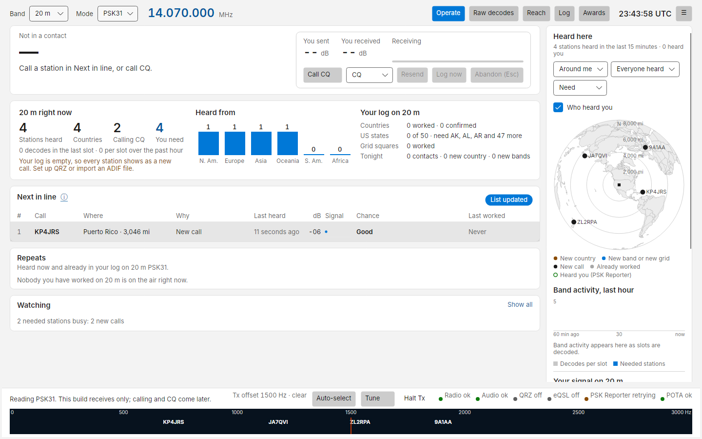
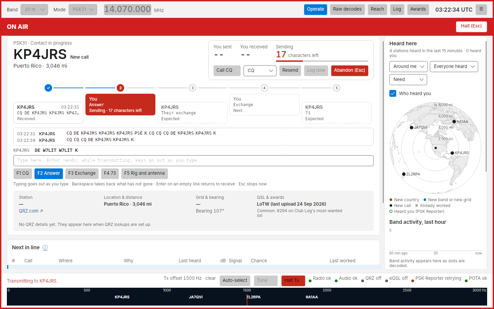
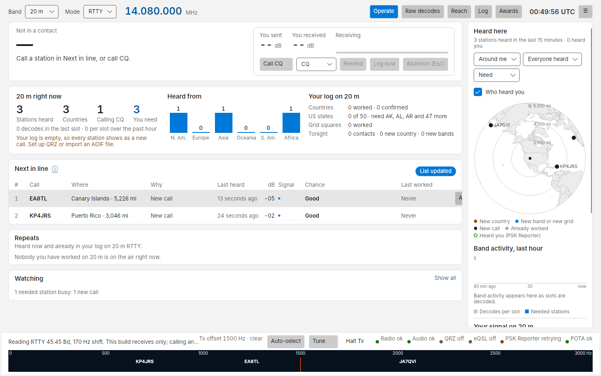

# PSK31, PSK63 and RTTY

!!! note "Preview"
    PSK and RTTY are new and have not yet been tried on the air. Watch your first few contacts closely, and keep
    **Halt Tx** (Esc) in reach.

Pick **PSK31**, **PSK63** or **RTTY** in the **Mode** menu. Costas tunes the radio to the band's PSK frequency
(14.070 MHz on 20 m) or RTTY frequency (14.080 MHz) in the same data mode it uses for FT8, so nothing else needs
changing on the radio. For RTTY that is right too: Costas makes and reads the two tones itself, so the radio's own RTTY
mode is not used.

## What you see

These modes have no time slots: stations type whenever they like, and Costas reads every signal in the receive
passband at once (up to 20).

- **Next in line, Repeats and Watching** work as they do for FT8. Costas finds each station's call in its text
  ("CQ CQ DE KP4JRS KP4JRS K", "W7LIT DE EA8TL") and ranks it by what you need. A station is listed as calling CQ
  for two minutes after its CQ, and the list refreshes every few seconds.
- **The waterfall** labels each signal with its station's call, "?" until Costas has read a call, and the station you
  are in contact with in red. Click a signal to read it, even before Costas has noticed it; it stays read while that
  station is quiet. When a reply comes back a little off that frequency, the same channel moves onto it. For RTTY, click either of its two tones or between them.
- **Signals without a callsign yet** are counted in a line under Next in line, with their audio frequencies.
- **Band activity** (right column) and the band summary count the stations read every three minutes, as there are no
  slots to count.
- **Raw decodes** shows the text, a line per over or per line typed, with the audio frequency and signal strength. The
  DT column is empty: these modes have no time offset. Only the current mode's lines are shown, so FT8 lines
  never mix with PSK or RTTY text.
- **dB** is measured in a 2,500 Hz bandwidth, the same scale as FT8, so −10 dB means the same in both.

There are no slots, so where FT8 shows the slot countdown the contact card shows how many characters you have typed
ahead, or how many are still to go while sending.

## Making a contact

Nothing is ever sent without a key press or a click from you.

**Answering a CQ.** Pick the station in **Next in line** and click **Call** (or double-click it). Costas sends your
answer (F2) on the station's own audio frequency and moves the contact strip on, just as for FT8:

1. Their CQ
2. Your answer (F2)
3. Their exchange: Costas reads their report, name, QTH and grid from what they send ("UR 579", "NAME JOSE",
   "QTH SAN JUAN.", "LOC FK68")
4. Your exchange (F3)
5. Their 73: the contact is logged

**Calling CQ.** Press F1 or **Call CQ**. A station that answers with your call starts the contact, and the strip runs
CQ, their call, your exchange (F3), their exchange, then your 73 (F4), which logs it.

**The conversation box** under the strip shows what each of you sent, with your own text dimmed. It keeps its size
and only follows new text while you are at the end, so words and keys do not move as you aim at them. If Costas read
a name or QTH wrong, or missed it, click the word in the conversation and choose what it is: their name, QTH, report,
grid or call. What you pick always wins over what Costas read, and the name and QTH to be logged show under the call.
A contact you abandon stays on the card, marked Abandoned, but stops collecting their text.

**Keys.**

| Key | While receiving | While sending |
| --- | --- | --- |
| Typing | Goes into the line under the conversation | Goes out as you type |
| Enter | Sends what you typed, or the next step's macro (its button is highlighted) | A new line (in RTTY sent as carriage return and line feed, as fldigi does); on an empty line, back to receive once everything has gone |
| Backspace | Edits the line | Takes back what has not gone out yet |
| F1 to F12 | Send that macro | Add that macro to what is going out |
| Esc | Abandons the contact | Stops sending at once; press again to abandon the contact |

These keys work wherever you last clicked on the Operate screen: typing, Space, Backspace and Enter always go to the
typing line, never to a button. A macro goes back to receive when it has gone out, unless you keep typing. Typed text
keeps the transmitter on, sending idle between words, until you press Enter on an empty line. Keys typed while an over
is closing wait in the typing line for your next Enter.

**Characters.** RTTY sends capitals only, so the typing line shows capitals in RTTY. A character the mode cannot send
(in RTTY `@ % & * # _ < > [ ] { }` and accented letters; in PSK anything outside plain ASCII) is named in red under
the typing line before you press Enter. If you press Enter anyway, nothing is sent, the bar says why, and your line is
kept so you can fix it. While sending, such a key is left out and named under the line.

**Resend and the CQ modifier** are FT8 and FT4 controls and are hidden in these modes: send again with the macro keys.

**Logging.** The contact is logged with the report, name and QTH shown on the card, and the frequency of the
station's signal (the dial plus its audio frequency). Reports are RST, such as 599. **Log now** logs it at any time
until you abandon the contact; if your exchange has not gone out yet, no sent report is logged. Calling CQ (F1) in the
middle of a contact ends it without logging, so log it first if you want to keep it. A station that calls you within two
minutes of a logged contact starts the next contact.

## Macros

The macro keys and your details are in **Settings › PSK and RTTY**. The defaults are:

| Key | Macro | Text |
| --- | --- | --- |
| F1 | CQ | `CQ CQ CQ DE {MYCALL} {MYCALL} {MYCALL} {MYGRID} K` |
| F2 | Answer | `{CALL} DE {MYCALL} {MYCALL} K` |
| F3 | Exchange | `{CALL} DE {MYCALL} [GE {NAME}] UR {RST} {RST} NAME {MYNAME} {MYNAME} QTH {MYQTH} HW? {CALL} DE {MYCALL} KN` |
| F4 | 73 | `[TNX {NAME}] 73 {CALL} DE {MYCALL} SK` |
| F5 | Rig and antenna | `RIG {MYRIG} ANT {MYANT}` |

Fill in **Your name**, **Your QTH** and your radio and antenna there first. A macro whose field has no value is not
sent: it appears above the typing line as it would go out, with the empty field in red, and the bottom bar says where
to fill it. Click the right word in the conversation (for their name or QTH) or fill in Settings, then press the key
again. Your report to them is 599.

A part in square brackets is optional: in F3, `[GE {NAME}]` goes out as "GE Jose" once you have their name, and is
left out when you do not, so a station that sends only its call can still be given your exchange. F4's `[TNX {NAME}]`
works the same way. Hover over a macro
key to see exactly what it will send. A name in braces that is not one of the fields (a typo such as `{MY_CALL}`)
stops the macro from going out until you correct it.

When you save, Settings checks every macro: a name in braces that is not one of the fields above (a typo such as
`{NAM}`) or a character neither mode can send stops the save and names the key. A character only RTTY cannot send, such
as `@`, is a warning: press Save again to keep it, and that key will be refused in RTTY. **Remove** empties a key (the
last added key goes altogether). If every key is empty, the default macros come back; Settings says so first.

## Away from the desk

- **Mini mode** shows the macro keys under the station instead of the step dots, with the next one in blue. F1 to F12
  work in the strip too.
- **The phone** shows the macro keys on the Operate tab instead of Resend and Call CQ (F1 is your CQ), with the last
  few lines of the conversation. You cannot type from the phone yet.
- **PSK Reporter.** With spot uploading on, stations Costas reads are reported as PSK31, PSK63 or RTTY, at the
  frequency of their signal.
- **Who hears you in RTTY.** PSK Reporter has few RTTY receivers, so RTTY reports come mostly from the
  [Reverse Beacon Network](maps.md#where-the-data-comes-from) skimmers, which spot you while you call CQ.
- **GridTracker and loggers** see the mode in the status Costas sends (with the report as RST, for example 599), and
  logged contacts as usual. Costas sends them no PSK or RTTY text, so calling a station from GridTracker works only in
  FT8 and FT4.

## Your log in PSK and RTTY

- PSK31 and PSK63 count as different modes for worked before: a station worked in PSK31 is still *New call* in PSK63
  on the same band. A PSK31 and a PSK63 contact with the same station minutes apart are two contacts, not one.
- Contacts in older logs that wrote `PSK31` or `PSK63` as the mode count the same as the ADIF 3 form (`PSK` with a
  submode), so importing an older log does not add the same contact twice.
- *Your signal*, **Reach** and *Who heard you* on the Heard here map show only reports of your signal in the mode you
  are in. **Worked tonight** names the mode of each contact.

## Safety

- Costas will not send outside the band's limits, and it drops PTT on any radio or audio error. The limits count the
  whole signal, so a wide RTTY shift needs more room from the band edge. A band with no row for the mode in the
  frequency table (60 m and 6 m have only FT8 and FT4) is refused for PSK and RTTY, with the reason in the bottom bar.
- If the radio refuses PTT when an over starts, nothing is sent and the bottom bar says why; the next key press tries
  again.
- Changing band or mode stops whatever is on the air, FT8 and Tune included. Typing a new frequency waits until the
  transmission ends.
- A single over stops after 3 minutes; the strip then says "Stopped by watchdog". An over you typed that has had
  nothing to send for 20 seconds simply goes back to receive, and the contact carries on. If the sound card stops
  taking audio for 5 seconds, PTT is dropped and the bottom bar says so.
- Holding a function key sends its macro once, and pressing it again while that macro is still waiting to go out is
  refused, so a macro is never queued twice by accident.
- RTTY keeps the transmitter at full output for the whole over. When you pick RTTY, Costas turns the radio's power down
  to half of what you set, and puts it back when you leave RTTY or close Costas (unless you turned the power yourself
  meanwhile). Change the share under **RTTY power** in Settings; 100 % leaves the power alone. Nothing is sent in RTTY
  until the cap is on the radio. Costas remembers the power to put back, so it is restored even after a crash; if the
  radio does not take it back, a note under the macro keys says what to set, and Costas tries again on the next mode
  change or reconnect.
- For PSK, automatic transmit level aims for no ALC at all, since any ALC action makes a PSK signal wider. It keeps a
  separate level for PSK on each band, so your FT8 level is not affected.
- RTTY goes out at the same audio level as FT8 on that band (the power cap above keeps it cool).
- Costas puts the radio in its data mode (DATA-U on Yaesu) for PSK and RTTY, as for FT8, and makes the tones itself.
  Leave the radio's own PSK and RTTY modes alone: its RTTY mode needs FSK keying and its PSK mode uses the radio's
  built-in modem, so neither carries Costas's audio.
- The speech processor does not touch audio in the data mode, so it can stay on for your phone work. Only if the radio
  has no data mode and Costas has to use plain USB, and the processor is on, does a warning appear under the macro
  keys; then turn it off on the radio. Costas does not change it.

## Tips

- Costas reads a signal down to about −10 dB (PSK31). Below that it shows nothing rather than guessing, and it never
  shows text from plain noise.
- PSK63 is twice as fast and needs a few dB more signal.
- Keep the radio's receive filter at least 2.5 kHz wide so every signal in the waterfall can be read.
- **AFC**, beside the macro keys, lets each channel follow a signal that drifts. It is on by default. On a crowded band,
  if the text of one station turns into another's, turn it off so each channel stays where it started.

## RTTY settings

RTTY has a few settings, in **Settings › PSK and RTTY**. The status line shows the ones in use, for
example "Reading RTTY 45.45 Bd, 170 Hz shift". **Reverse** is also beside the macro keys. It changes only how
Costas reads; what you send is always the right way round.

| Setting | Default | What it does |
| --- | --- | --- |
| **RTTY speed** | 45.45 baud | Almost all amateur RTTY is 45.45 baud. 50 and 75 are offered for the few who use them |
| **RTTY shift** | 170 Hz | The distance between the two tones. Almost all amateur RTTY uses 170 Hz |
| **Reverse** | off | Swaps the two tones. Turn it on only for a station whose text reads as gibberish while its signal looks clean |
| **Unshift on space** | on | Returns to letters after a space, as most stations expect. Turn it off if numbers keep turning into letters |

RTTY sends letters (as capitals), figures and `- ? : $ ' ! ( ) " # & . / ; ,`. Anything else, such as `@`, `%` or
`*`, is refused rather than sent; Costas never swaps it for something else.

Costas reads RTTY through fading that takes out one tone at a time, as long as the other tone stays above the noise.
