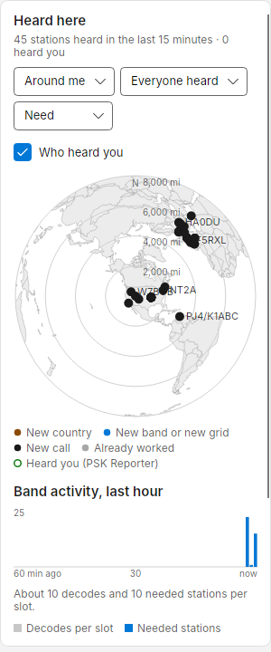
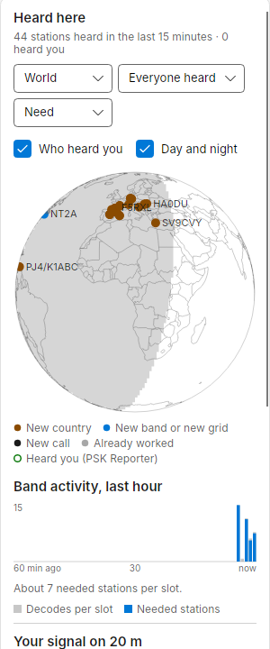
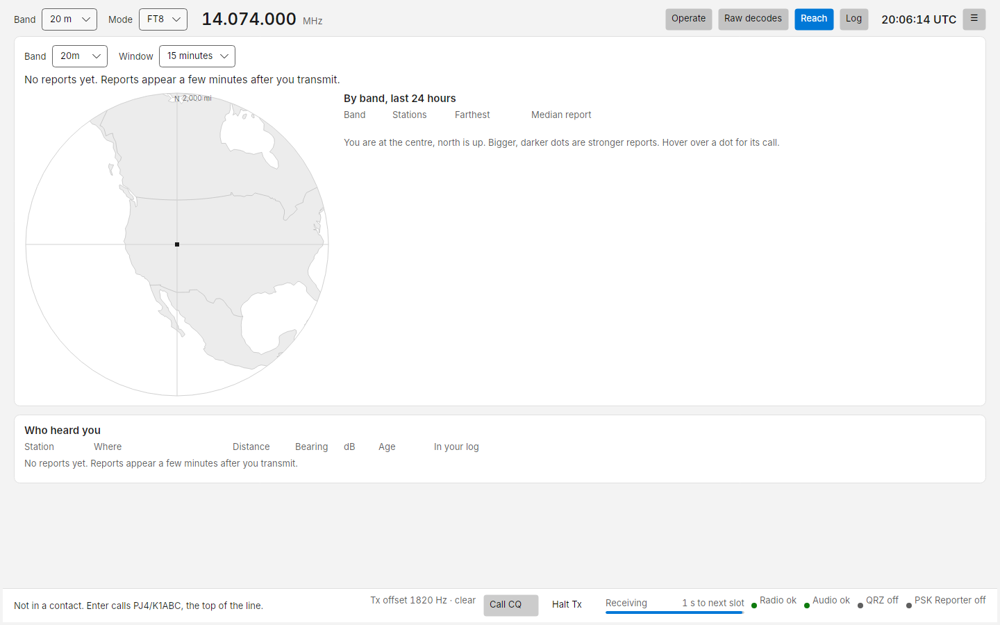
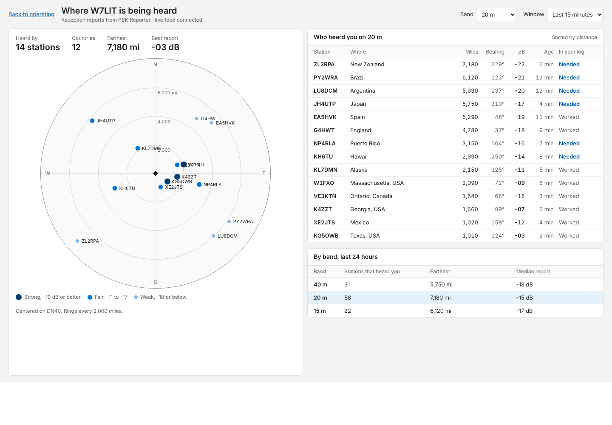

# Maps and who hears you

Costas has two maps. **Heard here** shows who you hear. **Reach** shows who hears you, from PSK Reporter. Both are
centred on your grid square, so set it in [Settings › Station](settings.md#station) first.

## Heard here

The first card in the right column of Operate. Each dot is a station you decoded in the last 15 minutes. Hover over
a dot for its call, place, need, report and when it was heard. Your choices are remembered.

{ width="300" }
{ width="300" }

| Control | Options |
| --- | --- |
| View | **Around me**: centred on you, north up, with distance rings. **World**: a flat world map |
| Show | **Everyone heard**, **Needed only**, **Calling CQ** |
| Colour by | **Need** (new country amber, new band or grid blue, new call black, worked grey), **Signal** (strong, fair, weak), **Last heard** (last minute, 1 to 5 minutes, 5 to 15 minutes) |
| **Who heard you** | Adds a hollow ring for each PSK Reporter receiver that heard you in the last 15 minutes. A station you hear that also hears you shows as a dot inside a ring |
| **Day and night** | World view only: shades the night side of the earth, so you can see the greyline |

The legend under the map says in words what each colour means. Labels that would overlap are dropped; hover to see
them. Without a grid, the map falls back to the World view and asks you to set your grid.

## Reach view

Press **Reach** in the top bar (++ctrl+3++), or **Open reach view** under *Your signal* in the right column.

- **Band** and **Window** (15 minutes, 1 hour, 24 hours) choose which reports to show.
- **Headline**: heard by how many stations, in how many countries, the farthest and the best report.
- **Plot**: you are at the centre, north is up, with rings every 2,000 miles (or 3,000 km). Each dot is a station
  that reported you, at its bearing and distance. Bigger, darker dots are stronger reports: strong (-10 dB or
  better), fair (-11 to -17), weak (-18 or below).
- **Who heard you**: the reporting stations with where, distance, bearing, dB, age and whether they are in your log.
  Sortable. Double-click a row for that station's details.
- **By band, last 24 hours**: how many stations heard you on each band, the farthest and the median report.
- **Compared with stations near you**: is it the band, or your station? PSK Reporter also hears the other stations
  within 300 miles of you. For every receiver that heard both you and one of them in the last 30 minutes, Costas
  compares the two reports, then sums it up per continent: *7 dB weaker than stations near you into Europe.* A
  continent shows once 3 receivers have heard both. The same line appears under *Your signal* on the Operate screen.
  Bear in mind a neighbour running more power than you makes you look weaker.

Reports appear a few minutes after you transmit. Until then the view says *No reports yet*.

The populated Reach view looks like this design mock-up (sample data):

<!-- TODO screenshot: replace the mock-up with a real Reach view once the app has been on the air with PSK Reporter. -->

## Where the data comes from

Reports of your signal come from [PSK Reporter](https://pskreporter.info/), live through its MQTT feed, with a
periodic query as a fallback. The caption under *Your signal* says which: *PSK Reporter · live*,
*· updated 6 min ago* (fallback), or *· unavailable*. Turn the feed on or off in
[Settings › PSK Reporter](settings.md#psk-reporter). Without it, the maps and the station list still work, but
*Hears you* stays blank.
