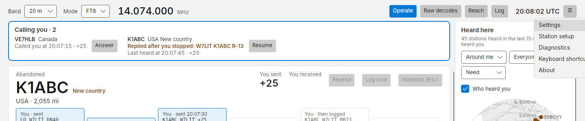
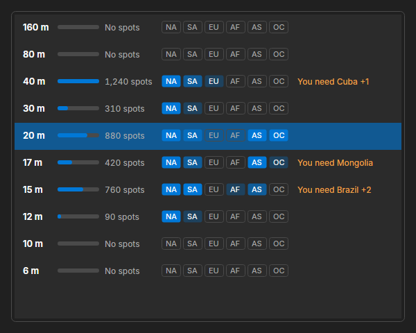
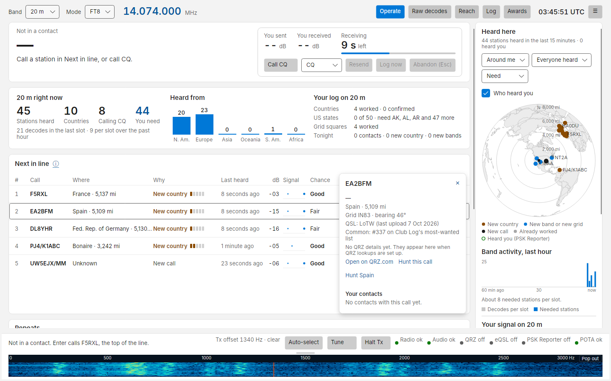
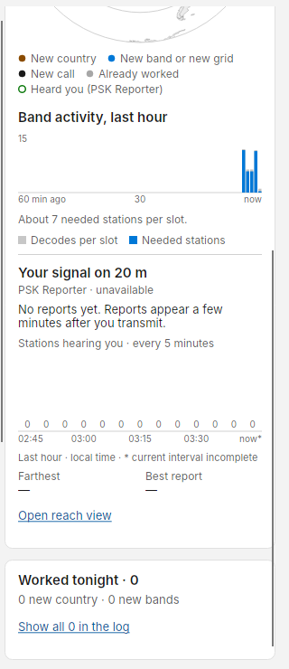
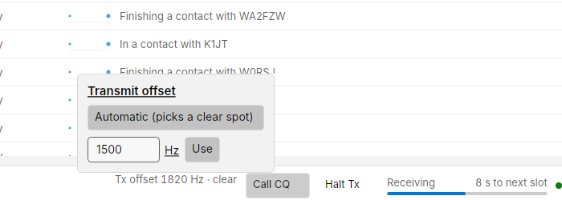
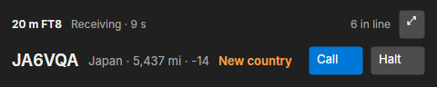
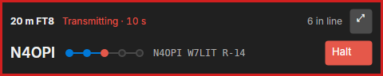

# The Operate screen

Operate is where you spend your time on the air. Everything you need during a session is on this one screen; you
should not need Settings while operating.

## Top bar

| Item | What it does |
| --- | --- |
| **Band** | The band you are on, filled in at start-up. Changes band: Costas sets the radio's dial frequency, clears the station list and loads your log totals for the new band. Locked while transmitting |
| **Mode** | FT8 or FT4. Changes the slot length and dial frequency. Locked while transmitting |
| Frequency | The dial frequency read from the radio, in MHz |
| **Operate**, **Raw decodes**, **Reach**, **Log** | The four views. ++ctrl+1++ to ++ctrl+4++ |
| Clock | UTC. Turns amber with a tooltip when your clock is off by more than 0.5 s, red above 2 s |
| **☰** | Mini mode, Settings, Station setup, Diagnostics, Keyboard shortcuts, About |

### Which bands are open

Open the **Band** menu to see, before you switch, which bands are open from your area right now. For each band it shows how many PSK Reporter spots stations within 300 miles of you got in the last 15 minutes, which continents heard them (darker means more), and countries hearing them that you still need on that band, for example *You need Brazil +2*. Hover over it for the full list.

{ width="600" }

It needs **Receive live reports of stations hearing my signal** and **Show band activity near me in the band menu** in [Settings](settings.md). The rows fill in once PSK Reporter has reported your own signal, which tells Costas your country; Costas remembers it, so after that they fill in at start-up. Until then each row says *Needs a spot of you*. If PSK Reporter sends more reports than Costas can keep up with, it follows only the band you are on and the other rows say *Too busy to follow* until you restart Costas.

Two banners can appear under the top bar:

- **ON AIR** (red) while Costas is transmitting, with the message being sent and a **Halt (Esc)** button.
- **Radio not connected** (amber) when the radio is not set up or not answering, with a **Station setup** button.

## The top slot: band summary

When you are not in a contact, the top card summarises the band.

**20 m right now** (named after the current band): stations heard in the last 5 minutes, how many countries, how
many are calling CQ, and **You need** (stations that are new to you in some way). The line under it gives decodes
in the last slot and the average per slot over the past hour.

**Heard from**: a bar per continent (N. Am., Europe, Asia, Oceania, S. Am., Africa).

**Your log on 20 m**: countries worked and confirmed on this band, US states worked (and the first few you still
need), grid squares worked, and **Tonight**: contacts, new countries and new bands this session. A session starts
when you open Costas, or after 2 hours with no contact.

When you call or answer a station, this card becomes the contact panel. See [Making contacts](contacts.md).

## Next in line

The stations you need that you can call right now, best first. At most 12 rows; the rest are counted underneath.

A station calling CQ stays listed for 2 minutes after it was last heard (change this in
[Settings › Who to call](settings.md#who-to-call)), so one missed decode does not drop it. *Doing now* then says
*Calling CQ, missed last slot*, and it sorts below stations heard in their latest slot. It leaves the list as soon as
it is heard working someone else, and moves to Watching once the time is up.

| Column | Meaning |
| --- | --- |
| **#** | Rank |
| **Call** | Callsign |
| **Where** | Country (or state for the USA, province for Canada) and distance |
| **Why** | Why you need them: **New country**, **New band** (hover to see which bands you already have that country on), **New grid** with the grid, such as **New grid DO62**, or **New call**. A new country also gets a small rarity meter, five cells from common to very rare, from Club Log's most-wanted list. Hover for its rank |
| **Doing now** | *Calling CQ, 3 slots*, *Calling CQ DX*, *Calling you*, and *fading* when their signal is dropping |
| **Last heard** | How long ago their last decoded transmission ended, counting up every second |
| **dB** | Their signal at your station |
| **Signal** | A sparkline of their last 6 slots, gaps where they were not decoded. Hover for the values |
| **Chance** | **Good**, Fair or Long shot, with what it is based on beside it: *hears you at -22* (they reported you on PSK Reporter), *heard in Japan at -17* (someone in their country or area did), or *no reports yet*. With no reports, a station at -18 dB or better is Fair and a weaker one is a Long shot |
| **Last worked** | Your most recent contact with that call on any band or mode (*2026-10-03 · 40 m*), or *Never*. Hover for the details |
| button | **Call**, or **Answer** when they are calling you |

How the order works: stations are grouped by need (new country first), then by chance, then by how well they hear
you, then by their signal. The **ⓘ** beside the title shows the current rules in one sentence; click it to change
them (the same options as [Settings › Who to call](settings.md#who-to-call)).

The list never reshuffles under your mouse. If it needs to re-rank while you are pointing at it, a **List updated**
pill appears; it applies when you click it or move the pointer away.

The station you are in a contact with is tinted, with a bar down its left edge, the same in Repeats. That tint
only ever marks the station you are working.

Selecting a row (click, or ++up++ / ++down++) outlines it and shows a details card with the station's name (from QRZ lookups),
location, grid, bearing and your past contacts with that call:

### Who else is calling

When other stations are calling the one you selected, the details card adds a **Who else is calling** section:

- how many stations called it in its latest answer slot, with each caller's signal at your station and audio offset;
- whether your transmit offset is clear of them, or which caller is sitting on top of it;
- once it has answered a few callers, how it chooses: *Answered the strongest caller you heard in 4 of its last 5 contacts.*

It is built from your own decodes, so it only knows the callers you can hear, and a caller that is strong for you may be
weak for them. The same section shows in the **About** card while you are calling that station.

To call a station: click its **Call** button, double-click the row, or select it and press ++enter++.

!!! note "Chance without PSK Reporter"
    If PSK Reporter is off or unreachable, chance is worked out from their signal alone: Good at -10 dB or better,
    Fair at -18 or better, otherwise Long shot.

## Repeats

Directly under Next in line: stations you can hear now that are already in your log on this band and mode. Next in
line leaves them out because you do not need them, but you may still want to work them again: a friend, a regular,
or someone you owe a better report. At most 8 rows; the rest are counted underneath.

It has the same columns as Next in line, lined up under them, with two differences:

- **Why** says whether your contact with them on this band and mode is confirmed: ***Not confirmed*** or *Confirmed*.
  Stations not confirmed are listed first, as working them again is the usual reason to call.
- **Doing now** says why they cannot be called right now instead, in grey: *In a contact with EA5HVK*, *Went quiet
  2 minutes ago* (counting up, like Last heard). The **Call** button still works, so you can call a station that went quiet or is finishing a
  contact. A station *in a contact* with someone else is not called: the contact card says *In another contact* and
  why (see [Making contacts](contacts.md)).

**Last worked** shows when and on which band you last worked them: *Today · 20 m*, *Yesterday · 40 m*,
*2026-10-03 · 20 m*. Hover for the number of contacts, the exact time, the mode and whether it is confirmed.

Stations you can call now come first, then the same order as Next in line. Like Next in line, the list holds still
while your pointer is over it and catches up when you move away. When nobody you have worked on this band is on the
air, it says so.

## Watching

Stations you need that you cannot call yet: they went quiet, or are in a contact with someone else
(*In a contact with EA5HVK*, *Finishing a contact with K7RGB*). They move into Next in line when that changes.

A station calling CQ in a contest (`CQ RU`, `CQ FD`, `CQ WW`, `CQ TEST` and the like) is listed here as *Contest
(CQ RU), needs an exchange*. It expects a contest exchange, and Costas only sends the standard one, so it is not
offered as a station to call.

When everyone in Watching is only a new call or a new grid, the list folds to one line, such as *12 needed stations
busy: 11 new calls, 1 new grid*. **Show all** opens it and **Fold** closes it again; Costas remembers your choice until
you change it. A new country or a new band is never folded away: as soon as one is in Watching, its rows show.

Stations you have already worked on this band are not in Watching; they are in [Repeats](#repeats).

## Right column

From top to bottom:

- **Heard here**: a map of the stations you have decoded in the last 15 minutes. See
  [Maps and who hears you](maps.md#heard-here).
- **Band activity, last hour**: a bar per minute of decodes per slot (grey) and needed stations per slot (blue),
  with a sentence saying whether the band is busier or quieter than half an hour ago.
- **Your signal on 20 m**: how many stations hear you, the farthest and the best report.
  **Open reach view** goes to the full view.
- **Worked tonight**: your latest contacts this session with their QRZ upload state. **Show all in the log** opens
  the Log view.

{ width="320" }

## Bottom bar

| Item | What it does |
| --- | --- |
| Status text | One line: *Not in a contact. Enter calls NT2A, the top of the line.*, *Transmitting to F5RXL.*, *Waiting for F5RXL.*, or a fault in red |
| **Tx offset 1650 Hz · clear** | Your transmit audio offset. Click to choose **Automatic (picks a clear spot)**, the default, or type a fixed value (200 to 2900 Hz) and press **Use** |
| **Call CQ** | Starts calling CQ in the next slot. Becomes **Stop CQ** while running. ++ctrl+q++ |
| **Tune** | Starts your radio's own antenna tuner, as its TUNE button would. If the radio has no tuner Costas can start (or its tuner is switched off), Costas sends a steady tone at your transmit offset for up to 10 seconds instead, for an external tuner. Becomes **Stop tune** for up to 10 seconds; click it to stop. Available only when nothing else is being sent; calling a station or CQ stops the tone |
| **Halt Tx** | Always available. Drops PTT at once and stops sequencing. ++esc++ does the same |
| Slot progress | *Receiving* or *Transmitting*, seconds to the next slot, and a bar |
| Meter warning | Appears only when the last transmission's SWR or ALC was high, for example *SWR 3.4 · ALC 70%* |
| Indicators | **Radio**, **Audio**, **QRZ**, **PSK Reporter**: a dot and a word each. Click to open Diagnostics |

Costas has no waterfall. With the offset on Automatic it picks a clear spot in the passband for you each time.

## Mini mode

Want to browse, log or check email while you keep an eye on the band? Choose **Mini mode** from the **☰** menu, or press ++ctrl+m++. Costas shrinks to a small strip that stays on top of your other windows.

{ width="480" }

The top row shows the band, the slot countdown and how many stations are in line. When someone calls you it says so in amber instead, for example *1 calling you*. The second row shows the station at the top of Next in line and why it's worth calling. **Call** calls it, exactly as calling it from the full window would.

During a contact the strip shows who you're working, a dot for each step of the contact, and the message on the air or the one you're waiting for. The strip is outlined in red while you transmit.

{ width="480" }

**Halt** is always there, and ++esc++ works in the strip too. Nothing is sent without a click.

To get the full window back, click **⤢** or close the strip. Costas remembers where you put it.
