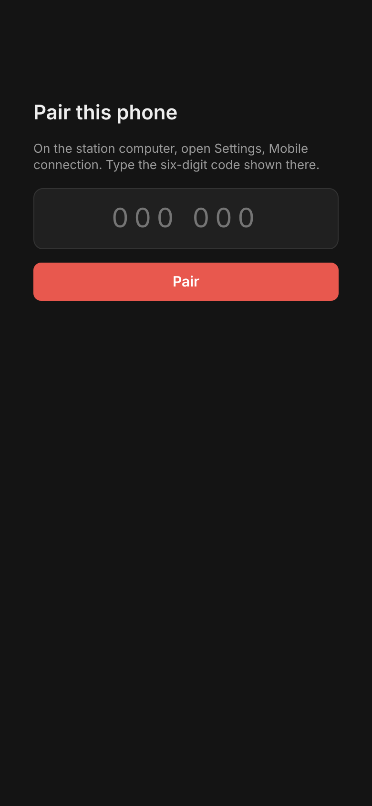

# Operating from a phone

Costas can serve a page to a phone on your home network, so you can work stations from the couch while the radio
stays on the station computer. The phone opens the page in its browser; there is nothing to install. It is off until
you turn it on.

{ width="320" }

## Turning it on and pairing a phone

1. On the station computer, open **Settings › Mobile connection** and tick **Let a paired phone on this network
   operate the station**. It starts at once; there is no need to save first.
2. If Windows asks whether Costas may use the network, choose **Allow** for private networks. Phones cannot connect
   until you do.
3. A **Pair a phone** card appears with the address to open on the phone, for example `http://192.168.1.20:8073/`,
   and a large six-digit code.
4. On the phone, open the address and type the code.

{ width="320" }

The code works once, only while the Settings window is open, for up to 10 minutes, and five wrong tries cancel it.
Press **New code** for another. The phone stays paired until you press **Forget paired phones**; to pair another
phone, open **Settings › Mobile connection** again and press **Pair a phone**.

## What the phone can do

- See the band and frequency, the radio, the clock and the decoder, and what is on the air.
- Follow the contact on the same five-step strip as the desk. Tap one of your upcoming steps to send it next.
- **Resend**, **Log now** (once both reports are exchanged) and **Abandon**.
- **Call CQ** or **Stop CQ**.
- Answer stations in **Calling you**, and call stations in **Next in line**.
- **HALT TX** is always at the bottom of the screen.

Settings, the log, band changes and the waterfall stay on the desk.

## Who is in control

The phone takes control as soon as it sends a command, and the desk shows **Phone in control** in the bottom bar.
A click or key press at the desk takes control back. The top of the phone page says **You control** or
**Desk controls**.

## Safety

While the phone has control:

- **Transmit stops if the phone goes quiet for 15 seconds.** The page checks in every 5 seconds. Locking the phone,
  closing the browser, switching apps or losing Wi-Fi all count as going quiet. Receiving and logging carry on, and
  nothing is sent again until you press **Call** or **Call CQ**.
- **The Tx watchdog is at most 3 minutes**, whatever it is set to in **Settings › Transmitting**.

Keep the page open on the screen while you operate.

{ width="320" }

Every other guard (band edge, clock, PTT released on any radio or audio fault) runs on the station computer exactly
as it does when you are at the desk.

!!! note "US operators"
    The FCC allows remote control of an amateur station. The control operator must be at the control point (here,
    the phone), and a station under remote control must stop transmitting within 3 minutes if the control link fails
    (47 CFR 97.109(c) and 97.213). The 15-second stop covers this.

## Security

- The page only answers addresses on your home network (and Tailscale's). Do not forward the port on your router.
- Only paired phones can see or operate the station.
- The page uses plain HTTP inside your network, like most home devices. Use it on a network you trust.
