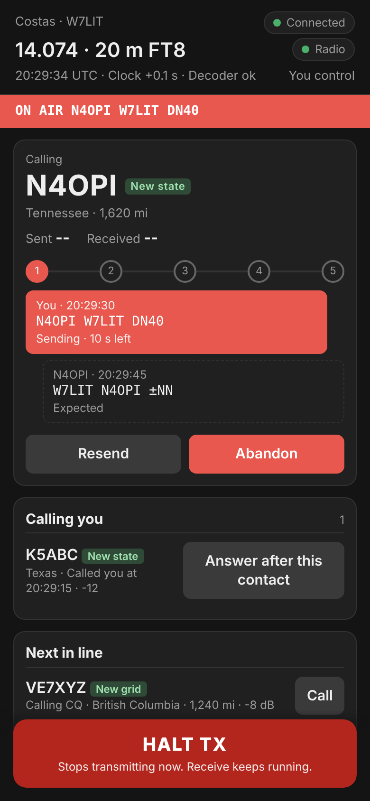
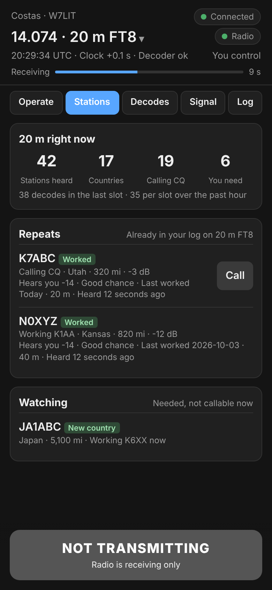
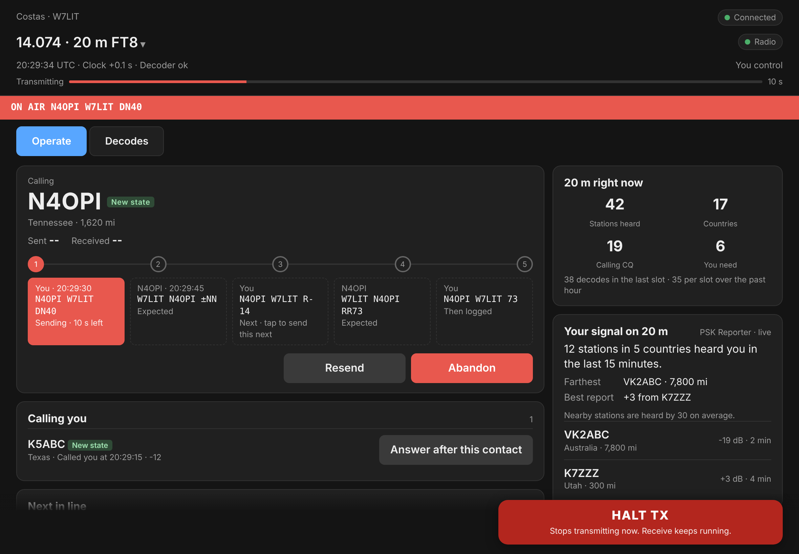
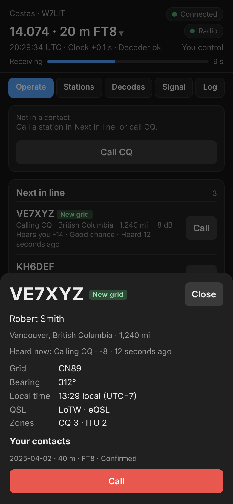
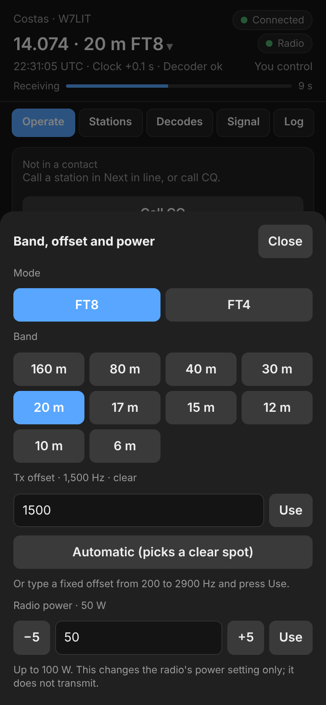
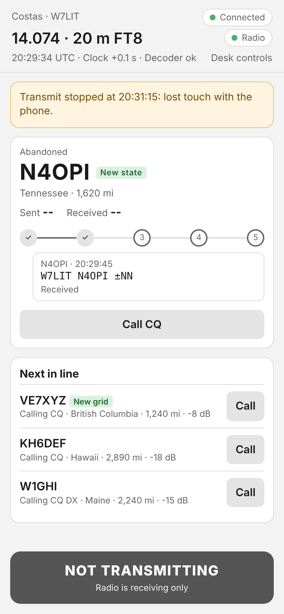

# Remote Operation (phone/tablet support on local network)

Costas can serve a page to a phone on your home network, so you can work stations from the couch while the radio
stays on the station computer. The phone opens the page in its browser; there is nothing to install. It is off until
you turn it on.

{ width="320" }

## Turning it on and connecting a phone

1. On the station computer, open **Settings › Mobile connection** and tick **Let a phone on this network operate the
   station**. It starts at once; there is no need to save first.
2. If Windows asks whether Costas may use the network, choose **Allow** for private networks. Phones cannot connect
   until you do.
3. Settings shows the address to open on the phone, for example `http://192.168.1.20:8073/`.
4. On the phone, open the address. There is no code to type: the page connects straight away.

Any phone or tablet on your home network can open the page and operate the station, so turn it off when you are not
using it if others share your Wi-Fi.

## Adding it to your home screen

The page can sit on your home screen with the Costas icon, like an app.

- **iPhone or iPad:** in Safari, tap **Share**, then **Add to Home Screen**. It opens full screen, without Safari's
  address bar.
- **Android:** in Chrome, open the menu and tap **Add to Home screen**. The icon opens the page in Chrome. Chrome only
  installs full-screen apps from secure (HTTPS) addresses, and Costas serves the page over plain HTTP on your home
  network.

If the station computer's address changes (for example, your router hands it a new one), add the page again from the
new address.

## What the phone can do

The top of the page shows the band and frequency, the radio, the clock and the decoder, who is in control, and a
countdown bar for the current slot (red while you transmit). Below it, five tabs cover what the desk's Operate view
shows. **HALT TX** is always at the bottom of the screen.

{ width="320" }

| Tab | What it shows |
|---|---|
| **Operate** | The contact on the same five-step strip as the desk (tap one of your upcoming steps to send it next), with **Resend**, **Log now** and **Abandon**; **Call CQ** or **Stop CQ**; **Calling you**; and **Next in line** with the same columns as the desk: what each station is doing, where it is, its signal, your chance, and when you last worked it |
| **Stations** | The band summary (stations heard, countries, calling CQ, you need), **Repeats** (stations already in your log on this band and mode) and **Watching** (needed, but not callable right now, and why) |
| **Decodes** | Band activity, newest first. Messages to you are highlighted, CQs are blue and your own transmissions are grey |
| **Signal** | Who hears you, from PSK Reporter: how many stations and countries in the last 15 minutes, the farthest and best reports, the latest reports, and the last hour of distinct receivers in five-minute intervals (the final interval is incomplete) |
| **Log** | The contacts you made tonight |

Under the top bar the page also shows the radio's SWR or ALC warning after a transmission that read outside limits,
a line when QRZ, PSK Reporter or the audio device is not working, and the latest [Hunt list](hunt.md) alert of the
last 15 minutes.

### On a tablet

On an iPad or other tablet (any screen 760 pixels wide or more) the same address opens a fuller layout, close to the
desk's Operate view. There are two tabs, **Operate** and **Decodes**. Next in line, Repeats and Watching are tables
with the desk's columns (Call, Where, Doing now, Signal, Chance, Last heard, Last worked). The contact card shows all
five messages under the strip. In landscape the band summary, your signal and tonight's contacts sit in a column on
the right; in portrait they follow below. Buttons are sized for fingers, station details open in a panel on the
right, and **HALT TX** sits in the bottom right corner. Turning the tablet switches layouts straight away.

### Station details

Tap a call anywhere (a row in a list, a line in Decodes, a report) to open what the desk's details flyout shows:
name and location from QRZ, grid, bearing, local time, QSL methods, zones, what it is doing now, a pile-up summary
and your past contacts with it. When the station can be called, the sheet has a **Call** (or **Answer**) button.

{ width="320" }

### Band, mode and Tx offset

Tap the frequency at the top to change band or mode, or the transmit offset. These work like the band menu and the
offset box on the desk: band changes wait until the current transmission ends, changing band ends a contact or CQ
(the phone asks first), and a fixed offset must be between 200 and 2900 Hz. Changes are saved, so the desk shows
them too.

{ width="320" }

### Radio power

The same sheet shows the radio's power setting under **Radio power**, the same as the power in the desk's bottom bar.
Type a power and press **Use**, or step it with **−5** and **+5**. Anything from 1 W up to the radio's maximum is
accepted; anything outside that is refused, not rounded. If the radio has its own minimum (5 W on the FT-710), it
keeps that and the phone says what it set.

- It only changes the power setting. It never keys the radio, and it is not allowed while a transmission is on the
  air (as with band changes).
- It needs a radio connected by CAT that reports its power. With an audio-only (VOX) radio the section does not show.
- On the FT-710 it needs Hamlib 4.6 or newer, which the Windows installer includes. Older Hamlib releases (such as
  the one many Linux distributions package) scale the FT-710's power wrongly, so Costas leaves power control off
  there rather than send the wrong power.

Settings, editing the log and the waterfall stay on the desk. Opening a station's details or switching tabs does not
take control; calling, answering, band, offset and power changes do.

## Who is in control

The phone takes control as soon as it sends a command, and the desk shows **Phone in control** in the bottom bar.
A click or key press at the desk takes control back. The top of the phone page says **You control** or
**Desk controls**.

## Safety

While the phone has control:

- **Transmit stops if the phone goes quiet for 15 seconds.** The page checks in every 5 seconds. Locking the phone,
  closing the browser, switching apps or losing Wi-Fi all count as going quiet. Receiving and logging carry on, and
  nothing is sent again until you press **Call** or **Call CQ**.
- **The Tx watchdog is at most 3 minutes**, whatever it is set to in **Settings › Transmitting**. It counts from your last
  tap. A contact the other station is already answering is finished first, then nothing more is sent until you tap
  **Call** or **Call CQ**.

Keep the page open on the screen while you operate.

{ width="320" }

Every other guard (band edge, clock, PTT released on any radio or audio fault) runs on the station computer exactly
as it does when you are at the desk.

!!! note "US operators"
    The FCC allows remote control of an amateur station. The control operator must be at the control point (here,
    the phone), and a station under remote control must stop transmitting within 3 minutes if the control link fails
    (47 CFR 97.109(c) and 97.213). The 15-second stop covers this.

## Security

- The page only answers addresses on your home network (and Tailscale's). Do not forward the port on your router.
- There is no pairing code: any device on your home network can open the page and operate the station. Turn the
  mobile connection off when you are not using it if you share your network.
- The page uses plain HTTP inside your network, like most home devices. Use it on a network you trust.
