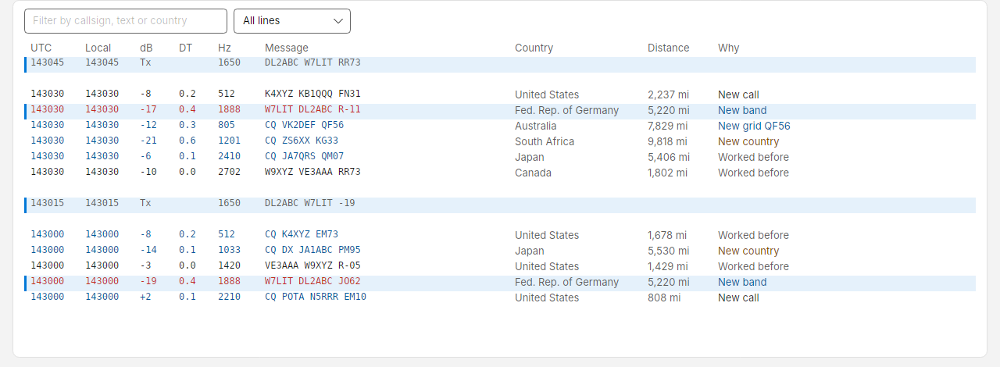

# Raw decodes

The classic message list, for when you want to see every line the decoder printed. Press **Raw decodes** in the top
bar or ++ctrl+2++.

| Column | Meaning |
| --- | --- |
| **UTC** / **Local** | Slot time, `HHMMSS` |
| **dB** | Signal-to-noise ratio at your station. Your own transmissions show `Tx` |
| **DT** | Time offset of the signal in seconds. A median near zero means your clock is right |
| **Hz** | Audio offset in the passband |
| **Message** | The message exactly as decoded |
| **Country** | The sender's country, from the country file |

- The newest slot is at the top, with a blank line between slots.
- Messages to you are red; CQs are blue.
- Scroll down to read older lines and the list stays put while new slots arrive; **Jump to live** takes you back to
  the top.
- Type in **Filter by callsign or text** to show only matching lines.
- Double-click a line to call its sender.
- Programs such as JTAlert and GridTracker can colour callsigns here (for example, ones you need), as they do in
  WSJT-X. See [Other loggers](log.md#other-loggers).
