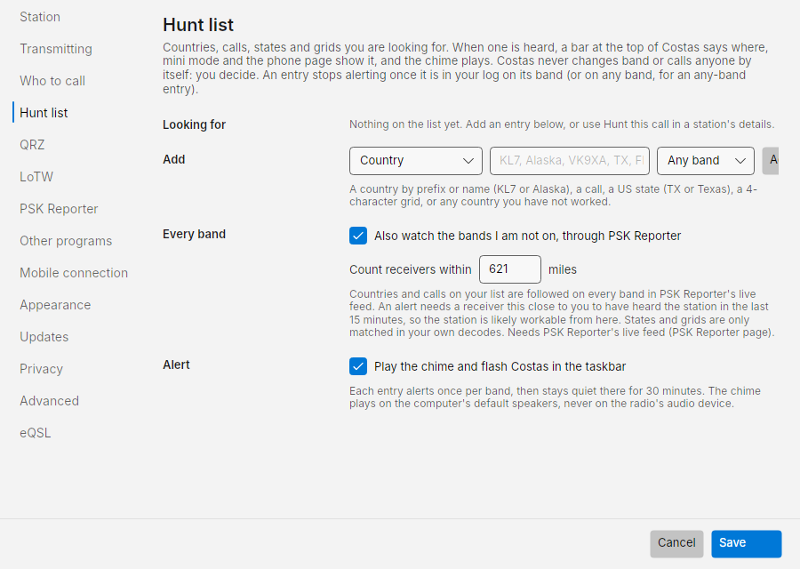
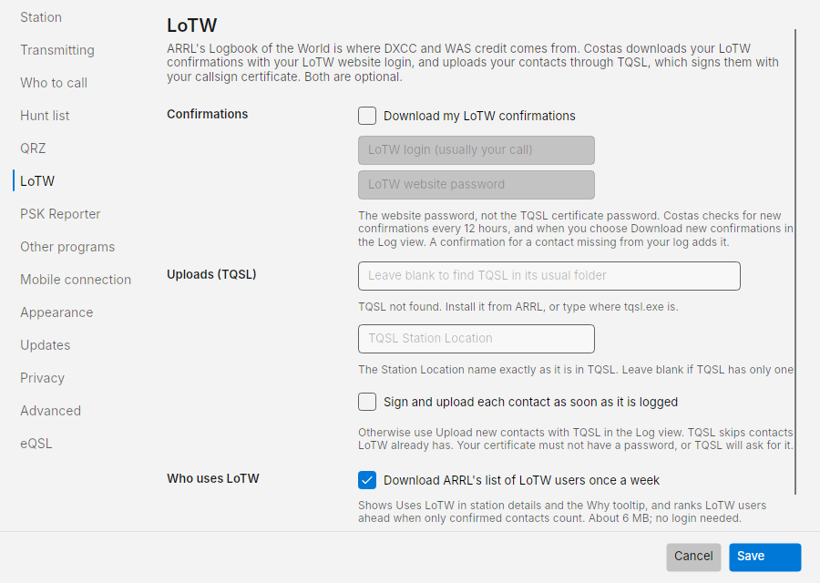
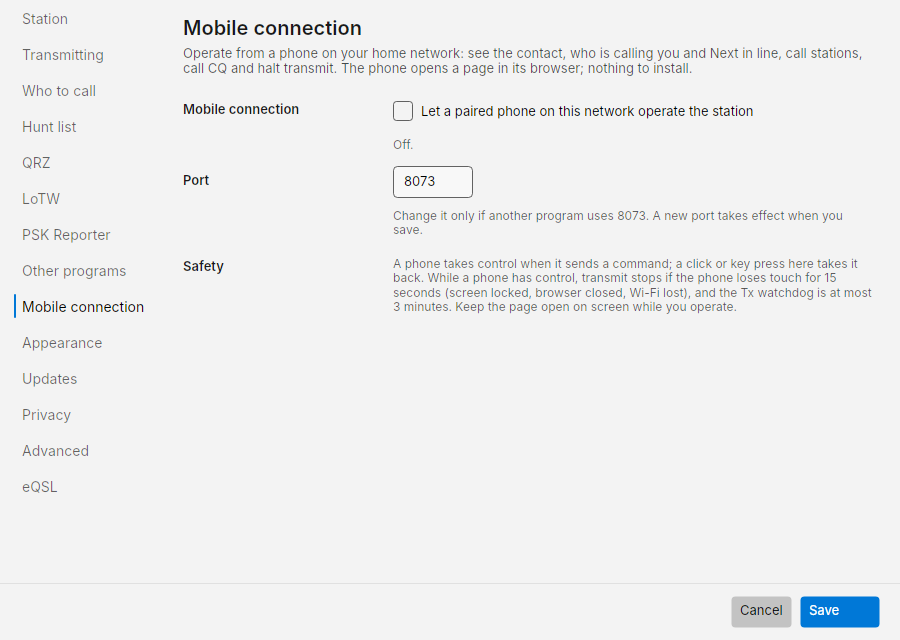
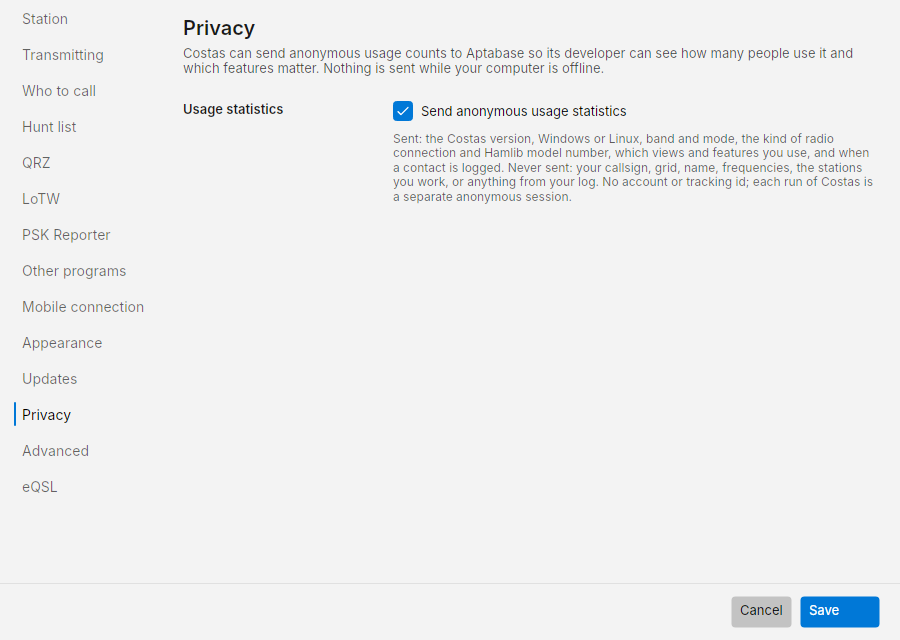
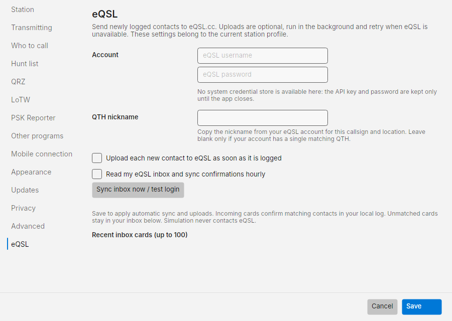

# Settings

Open **☰ › Settings**. Sections are listed on the left; press **Save** to keep changes or **Cancel** to drop them.
Radio, audio devices and the transmit test are not here: they are in **☰ › Station setup** (see
[First-run setup](setup.md)).

## Station

- **Station profile**: which setup you are operating from. Each profile keeps its own callsign, grid, power, radio,
  audio devices and QRZ logbook key, so a portable or park setup with a `/P` call or another grid is one choice away.
  **New profile** adds a copy of the profile shown (same radio and audio) called *Portable*; rename it in **Name**.
  **Delete** removes the profile shown (the last one cannot be removed). The profile shown when you press **Save** is
  the one Costas uses from then on; if it uses another radio or sound card, Costas reconnects to it. Set a profile's
  radio and audio in **Station setup** while it is the active one. Worked-before and log totals count the contacts
  logged under that profile's callsign.
- **Callsign** and **Grid square** (4 or 6 characters). Used in every message you send and to work out distances.
- **Power (watts)**: recorded in the log when the radio cannot report its own power setting. It does not change the
  radio's power.

## Transmitting

How contacts are run once you start one. Nothing is sent unless you click Call or Call CQ.

| Setting | Default | What it does |
| --- | --- | --- |
| **Audio level on 20m (dB)** | -6 | Level of the transmit audio sent to the radio on the current band, -40 to 0. Each band remembers its own level |
| **Adjust automatically from the radio's ALC** | on | After each transmission Costas reads the radio's ALC and nudges the level so ALC barely moves: up 0.5 dB when ALC did not move, down when it moved too much. Only the next transmission changes. It never goes more than 6 dB above, or 20 dB below, a level you type here. Turn it off to keep the level fixed. Needs a radio that reports ALC over CAT, such as the FT-710 or IC-7300 |
| **CQ** modifier | empty | Empty for a plain `CQ W7LIT DN40`, or `DX`, `POTA`, `NA`, a number and so on: `CQ DX W7LIT DN40`. The dropdown beside **Call CQ** on the Operate screen changes it too |
| **Answering a CQ › Send my grid** | on | Your first message is `THEIRCALL W7LIT DN40`. Off: just `THEIRCALL W7LIT` |
| **Sign-off on my CQ** | RR73 | When you called CQ: **RR73** ends the contact in one message; **RRR** waits for the other station's 73 |
| **Last message when answering** | 73 | When you answered: sent once after their RR73. The contact is already logged by then |
| **Then send free text** | none | Optional, up to 13 characters such as `TNX 73 GL`. Sent once in your next slot after the last message, unless you start another contact first |

**What you send** previews every message exactly as it will go out with your current choices. The order of the
exchange and the reports are fixed by FT8, so only the parts above can change.

| Setting | Default | What it does |
| --- | --- | --- |
| **Call CQ in** | even | Even slots start at :00 and :30, odd slots at :15 and :45 |
| **Give up after** | 4 | Tries without an answer before a contact ends as *No reply* |
| **Watchdog** | 6 minutes | Transmitting stops if you have not touched the app for this long. A contact the other station is answering is finished first |
| **Clock limit** | 2.0 seconds | Transmitting is blocked when the PC clock is off by more than this |
| **Clock correction** | on | When the PC clock is off, Costas times its slots, transmissions and log entries from internet time instead, checked every 15 minutes. The PC clock itself is not changed. Offsets over a minute are not corrected: set the Windows clock and time zone instead |
| **Logging** | on | Log each contact automatically when it completes |
| **Calling you › Chime** | off | A chime on the computer's default speakers when a new station calls you. Never on the radio's audio device |

## Who to call

How the Next in line list on the Operate screen is ordered. The same options open from the **ⓘ** beside *Next in
line*.

- **Priority**: the order of need tags. By default a new country outranks a new band, which outranks a new grid,
  which outranks a new call. Use ▲ ▼ to reorder.
- **Rank stations that hear me higher (from PSK Reporter)**: on.
- **Only list stations that are calling CQ**: on. Off also lists stations finishing a contact.
- **Hide stations I have already worked on this band**: on. They are listed in **Repeats** under Next in line instead.
- **Leave out long shots (signals too weak to likely complete)**: off.
- **Count a country or state as worked only when confirmed**: off.
    - **Count only LoTW confirmations (what DXCC and WAS credit)**: on. Off counts QRZ, eQSL and card confirmations too.
      With only confirmed contacts counting, stations that upload to LoTW rank ahead of those that do not.
- **Keep CQ callers listed**: 2 minutes. How long a station calling CQ stays in Next in line after it was last heard.
  Choices run from *Only while heard every slot* (the list drops a station the first slot it is missed) to 15
  minutes. A station heard working someone else leaves the list straight away whatever this says.
- **Parks on the Air: Show which park a station is activating (POTA spots)**: on. Costas reads the public spot list
  at pota.app every two minutes while it runs and shows *New park* or *Park* with the reference under **Why**
  ([Operate](operate.md#next-in-line)). When you log a contact with a spotted activator, the park goes into the log
  (see [Log](log.md#what-costas-logs)). If pota.app cannot be reached, the **POTA** indicator says so and Costas tries
  again less often; nothing else is affected. Off makes no requests.
  - **Rank stations at a park I have not worked higher**: on. A spotted activator at a park that is not in your log
    comes right after your first need (new countries by default) and ahead of everything else, and it is listed in
    **Next in line** even when you have worked that call on this band before. A station calling CQ POTA that nobody
    has spotted is not moved, since Costas cannot tell which park it is at.

## Hunt list

What you are looking for, and how you are told. See [Hunt list and alerts](hunt.md).

- **Looking for**: the entries, each with **Remove**.
- **Add**: the kind (Country, Call, US state, Grid, Any new country), what to look for, and a band or *Any band*.
- **Also watch the bands I am not on, through PSK Reporter**: on. **Count receivers within** 620 miles (1,000 km).
- **Play the chime and flash Costas in the taskbar**: on.

## QRZ

QRZ has two services, each with its own sign-in. Both are optional.

- **Logbook API key**: opens your logbook only, for what you have worked and confirmed and for uploading contacts.
  Find it in your QRZ Logbook's Settings. **Test key** checks it. **Open the QRZ Logbook** goes to qrz.com.
- **Sync**: **Read my logbook and upload new contacts**, **Upload each contact as soon as it is logged**, and
  **Check for changes every** 15 minutes.
- **Callsign lookups**: your QRZ username and password, for the name, city and state of other stations. **Test
  login** checks them. Leave both blank to turn lookups off.

The key and password are kept in Windows Credential Manager.

## LoTW

Logbook of the World confirmations, uploads through TQSL, and the list of LoTW users. See [LoTW](log.md#lotw).

- **Confirmations**: **Download my LoTW confirmations**, your LoTW login (usually your call) and LoTW website
  password. This is the website password, not the TQSL certificate password.
- **Uploads (TQSL)**: where `tqsl.exe` is (leave blank to find it in its usual folder), the TQSL **Station Location**
  to sign with (blank if TQSL has only one), and **Sign and upload each contact as soon as it is logged** (off).
- **Who uses LoTW**: **Download ARRL's list of LoTW users once a week** (on, about 6 MB, no login).

The password is kept in Windows Credential Manager.

## PSK Reporter

- **Who hears me › Receive live reports of stations hearing my signal**: on. Powers the Reach view and
  Chance.
- **Who hears me › Compare my signal with stations near me**: on. Also receives reports of other stations within
  300 miles on your band, for *Compared with stations near you* in the Reach view. Nothing about them is saved.
- **Who hears me › Show band activity near me in Reach and the band menu**: on. Receives reports of stations within 300 miles on
  every band, using the current grid square in **Station**, so Reach and the band menu show which bands are open from your area. Changing the grid switches the area. Nothing about these reports is saved.
- **Share what I hear › Send the stations I decode to PSK Reporter**: off. Helps other operators see where their
  signals reach. Sent every few minutes, never in simulation.

## Other programs

- **WSJT-X UDP › Send decodes, status and logged contacts**: on, to `127.0.0.1` port `2237`. Works with GridTracker
  and JTAlert on the same computer.
- **Save received audio**: none, only slots with decodes, or all, as WAV files, kept for 30 days by default.

## Mobile connection

- **Let a paired phone on this network operate the station**: off by default. Takes effect at once and shows a
  **Pair a phone** card with the address and a large one-time code.
- **Forget paired phones** unpairs them all. **Port**: `8073`, applied when you save.

See [Operating from a phone](phone.md).

## Appearance

- **Skin**: Classic (the original appearance and system accent), Ocean (cool blues), Forest (soft greens), or
  Amber (warm sand and copper). Four instrument skins also change the faceplate, typography, panel shapes and controls:
  **Modern Radio** has a recessed digital display and a dial button; **Classic Transceiver** has a gray and black
  faceplate, lime green seven-segment LCD digits and a black tuning dial; **Vintage Receiver** has warm dial lighting,
  brass trim, rounded controls and a sweeping slot needle; **SDR Console** has square modules, monospace readouts
  and a segmented slot strip. Their meters show progress through the current FT8 or FT4 slot; with one of these skins the faceplate is the
  only slot countdown, so the contact card and bottom bar leave theirs out. Click the large
  frequency display or **DIAL** button to open the same frequency editor used by Classic.
  Light and dark swatches preview your choice. Press **Save** to apply it to all desktop windows; it is remembered
  the next time you start Costas. Transmit and warning colors stay the same.
- **Theme**: system (follows your device's light or dark setting), light or dark. Each skin supports both.
- **Distances in**: miles or kilometres.

## Updates

**Check for a new build once a day** (on) and **Check now**. See [Install › Updates](install.md#updates).

## Privacy

**Send anonymous usage statistics** (on). Costas sends a few anonymous counts to [Aptabase](https://aptabase.com),
an open-source analytics service built for privacy, so its developer can see how many people use it and which features
matter. Untick the box to stop sending them.

What is sent:

- the Costas version and whether it is running on Windows or Linux;
- the band and mode you are on, and whether your radio is connected through Hamlib, VOX or not at all, with the Hamlib
  model number (the same number for every owner of that radio);
- which optional features are switched on (QRZ logbook, LoTW, eQSL, PSK Reporter, POTA spots, other programs, the
  phone remote) and how many entries your Hunt list has;
- which views and windows you open, and when you call CQ, call or answer a station, use Tune or a Hunt list alert,
  and log a contact (band and mode only).

What is never sent: your callsign, grid, name, frequencies, serial ports or network addresses, the stations you hear or
work, or anything from your log. There is no account and no tracking id; each run of Costas is a separate anonymous
session.

Nothing is sent while your computer is offline. Counts wait in memory (never on disk) and go out when the network is
back; anything still waiting when you close Costas is dropped. Statistics are never sent in simulation, and builds you
make yourself from the source send nothing at all.

## Advanced

Costas finds its decoder and radio control programs by itself. Set **jt9 decoder** (full path to `jt9.exe`) or
**Hamlib folder** (the folder containing `rigctld.exe`, or the Hamlib folder with it in `bin`) only to use a different copy, for example a newer Hamlib
for a radio the bundled one does not support.

## Developer mode

Hidden by default. In **☰ › About**, click the product name seven times. Settings then has a **Developer** section
(replay the sample recordings instead of the sound card, optionally with a simulated station that answers your
calls), and Station setup lists Hamlib's test radio, *Hamlib Dummy*, which never plays transmit audio. This is for
testing Costas, not for operating.

## eQSL

In **Settings › eQSL**, enter your eQSL.cc username and password, and copy the **QTH nickname** for the
current callsign and location from your eQSL account. Credentials stay in the system credential store when
available. Each station profile has its own account settings.

Enable **Upload each new contact** for automatic uploads. Contacts queue locally and retry after failures,
even after restarting Costas. The Log view shows eQSL delivery independently of QRZ.

Enable **Read my eQSL inbox** to fetch incoming cards hourly. **Sync inbox now / test login** reads the inbox
with the values entered on this page, even before saving them. A sync stores incoming cards and confirms a
local contact when its callsign, band, mode and UTC minute uniquely match. Unmatched cards remain visible in
the recent inbox list; they do not create contacts automatically. FT4 and MFSK/FT4 match as the same mode.

Both automatic features are off by default. Save to apply. Simulation never contacts eQSL.
