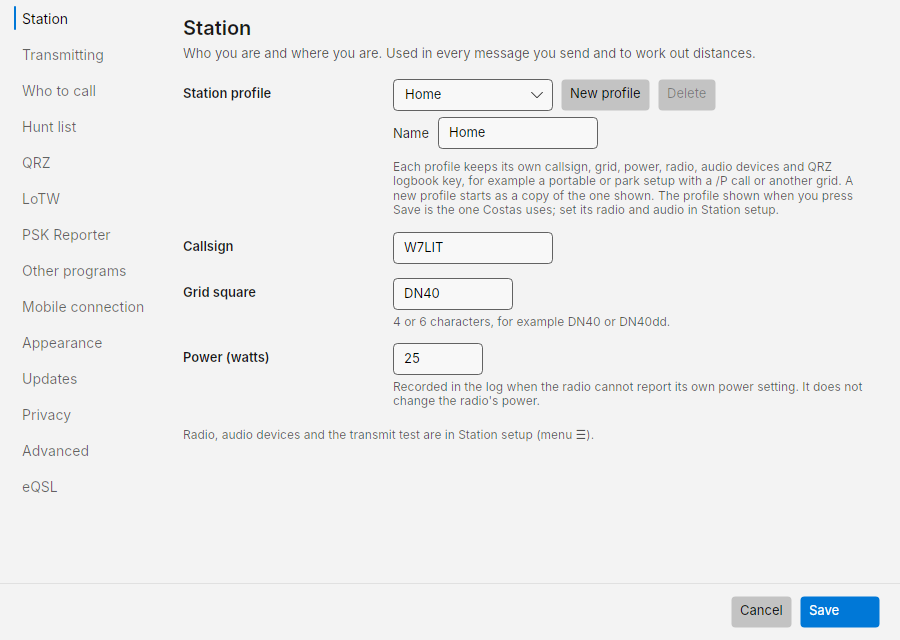
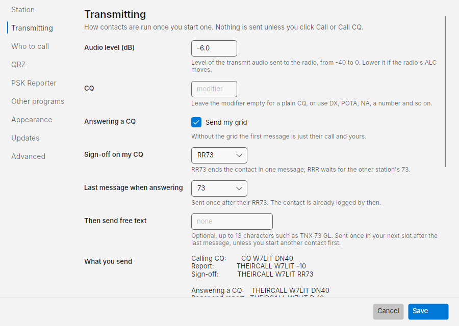
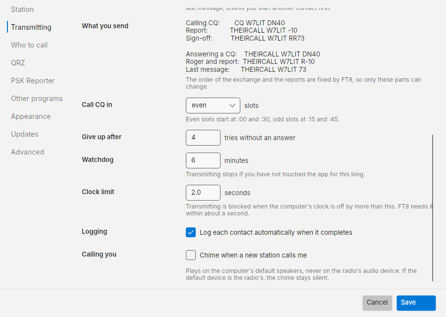
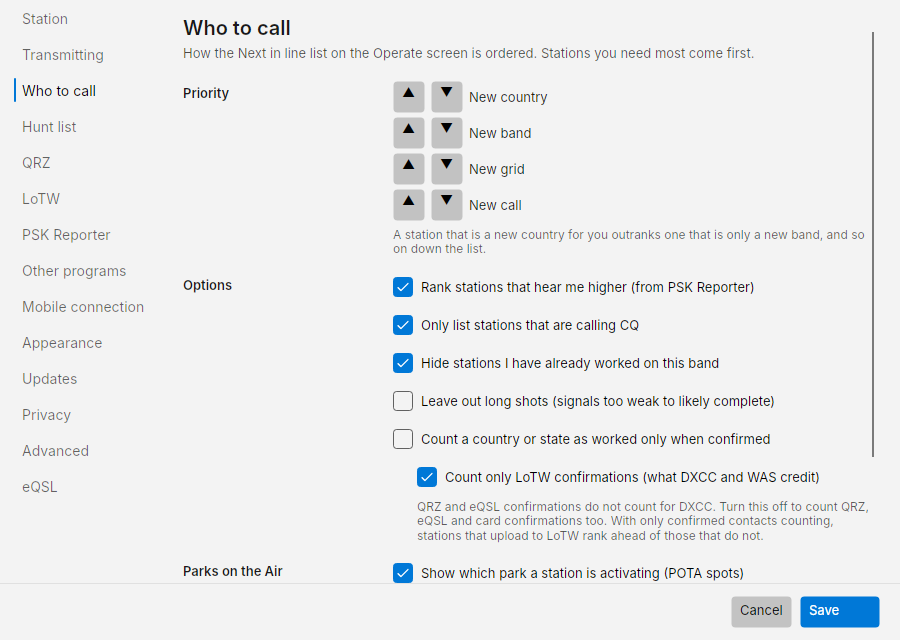
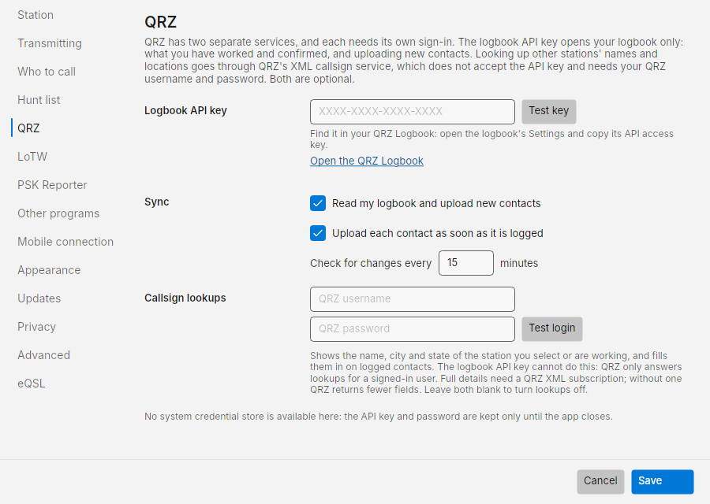
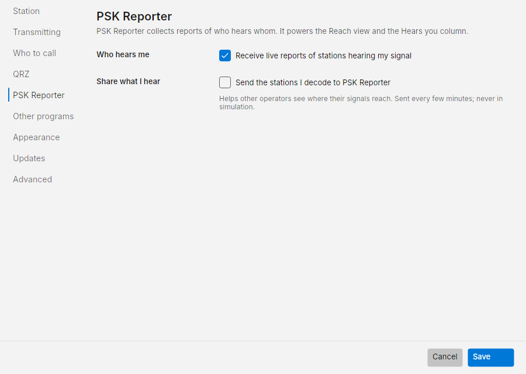
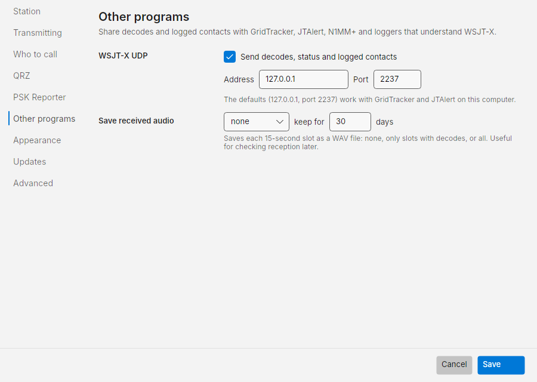
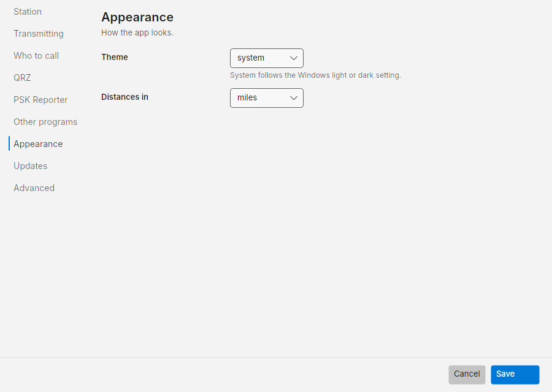
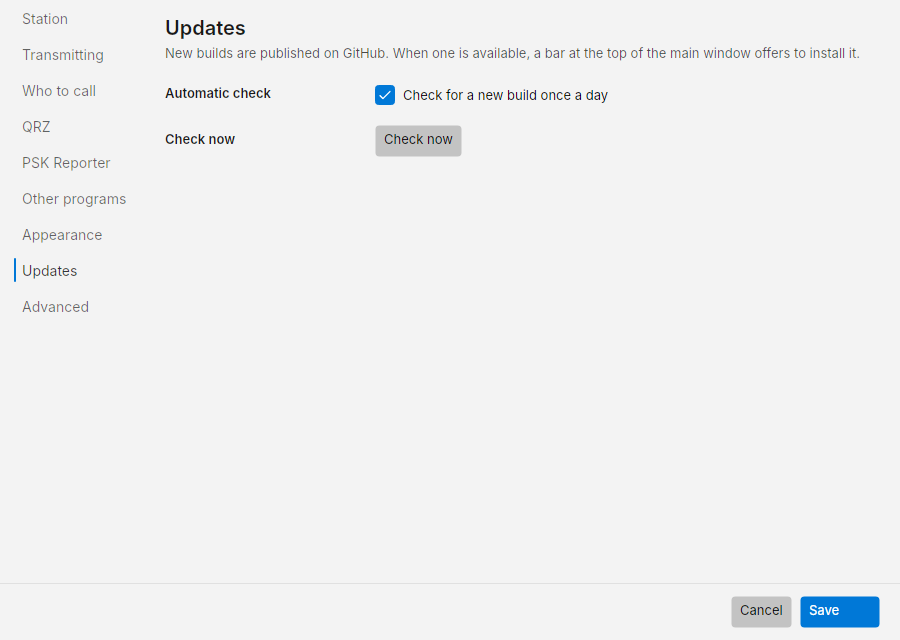
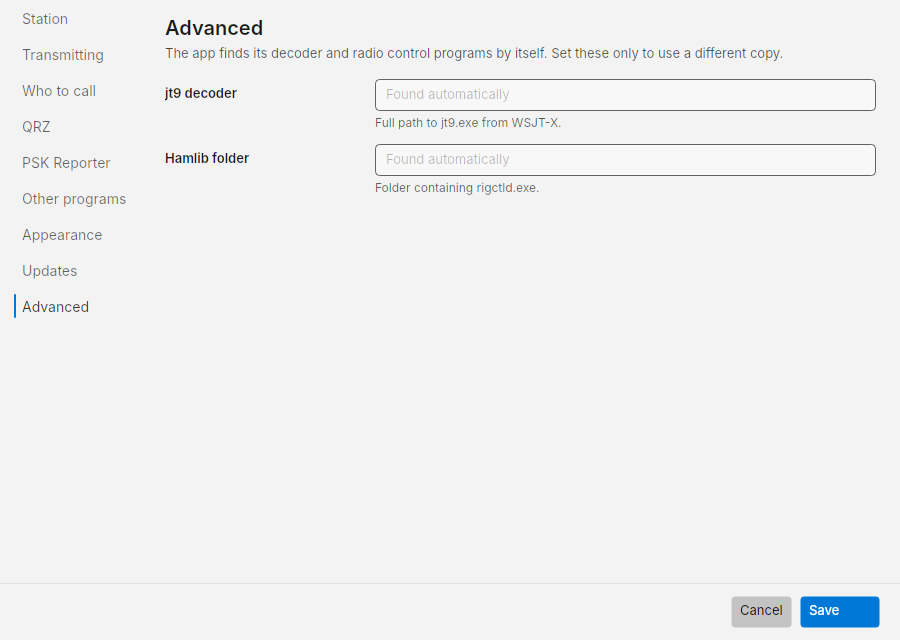

# Settings

Open **☰ › Settings**. Sections are listed on the left; press **Save** to keep changes or **Cancel** to drop them.
Radio, audio devices and the transmit test are not here: they are in **☰ › Station setup** (see
[First-run setup](setup.md)).

## Station

- **Callsign** and **Grid square** (4 or 6 characters). Used in every message you send and to work out distances.
- **Power (watts)**: recorded in the log when the radio cannot report its own power setting. It does not change the
  radio's power.

## Transmitting

How contacts are run once you start one. Nothing is sent unless you click Call or Call CQ.

| Setting | Default | What it does |
| --- | --- | --- |
| **Audio level (dB)** | -6 | Level of the transmit audio sent to the radio, -40 to 0. Lower it if the radio's ALC moves |
| **CQ** modifier | empty | Empty for a plain `CQ W7LIT DN40`, or `DX`, `POTA`, `NA`, a number and so on: `CQ DX W7LIT DN40` |
| **Answering a CQ › Send my grid** | on | Your first message is `THEIRCALL W7LIT DN40`. Off: just `THEIRCALL W7LIT` |
| **Sign-off on my CQ** | RR73 | When you called CQ: **RR73** ends the contact in one message; **RRR** waits for the other station's 73 |
| **Last message when answering** | 73 | When you answered: sent once after their RR73. The contact is already logged by then |
| **Then send free text** | none | Optional, up to 13 characters such as `TNX 73 GL`. Sent once in your next slot after the last message, unless you start another contact first |

**What you send** previews every message exactly as it will go out with your current choices. The order of the
exchange and the reports are fixed by FT8, so only the parts above can change.

| Setting | Default | What it does |
| --- | --- | --- |
| **Call CQ in** | even | Even slots start at :00 and :30, odd slots at :15 and :45 |
| **Give up after** | 4 | Tries without an answer before a contact ends as *No reply* |
| **Watchdog** | 6 minutes | Transmitting stops if you have not touched the app for this long |
| **Clock limit** | 2.0 seconds | Transmitting is blocked when the PC clock is off by more than this |
| **Logging** | on | Log each contact automatically when it completes |
| **Calling you › Chime** | off | A chime on the computer's default speakers when a new station calls you. Never on the radio's audio device |

## Who to call

How the Next in line list on the Operate screen is ordered. The same options open from the **ⓘ** beside *Next in
line*.

- **Priority**: the order of need tags. By default a new country outranks a new band, which outranks a new grid,
  which outranks a new call. Use ▲ ▼ to reorder.
- **Rank stations that hear me higher (from PSK Reporter)**: on.
- **Only list stations that are calling CQ**: on. Off also lists stations finishing a contact.
- **Hide stations I have already worked on this band**: on. They are listed in **Repeats** under Next in line instead.
- **Leave out long shots (signals too weak to likely complete)**: off.
- **Count a country or state as worked only when confirmed**: off.
- **Keep CQ callers listed**: 2 minutes. How long a station calling CQ stays in Next in line after it was last heard.
  Choices run from *Only while heard every slot* (the list drops a station the first slot it is missed) to 15
  minutes. A station heard working someone else leaves the list straight away whatever this says.

## QRZ

QRZ has two services, each with its own sign-in. Both are optional.

- **Logbook API key**: opens your logbook only, for what you have worked and confirmed and for uploading contacts.
  Find it in your QRZ Logbook's Settings. **Test key** checks it. **Open the QRZ Logbook** goes to qrz.com.
- **Sync**: **Read my logbook and upload new contacts**, **Upload each contact as soon as it is logged**, and
  **Check for changes every** 15 minutes.
- **Callsign lookups**: your QRZ username and password, for the name, city and state of other stations. **Test
  login** checks them. Leave both blank to turn lookups off.

The key and password are kept in Windows Credential Manager.

## PSK Reporter

- **Who hears me › Receive live reports of stations hearing my signal**: on. Powers the Reach view, *Hears you* and
  Chance.
- **Who hears me › Compare my signal with stations near me**: on. Also receives reports of other stations within
  300 miles on your band, for *Compared with stations near you* in the Reach view. Nothing about them is saved.
- **Share what I hear › Send the stations I decode to PSK Reporter**: off. Helps other operators see where their
  signals reach. Sent every few minutes, never in simulation.

## Other programs

- **WSJT-X UDP › Send decodes, status and logged contacts**: on, to `127.0.0.1` port `2237`. Works with GridTracker
  and JTAlert on the same computer.
- **Save received audio**: none, only slots with decodes, or all, as WAV files, kept for 30 days by default.

## Phone

- **Let a paired phone on this network operate the station**: off by default. **Port**: `8073`.
- **Pair a phone** shows a one-time code to type on the phone; **Forget paired phones** unpairs them all.

See [Operating from a phone](phone.md).

## Appearance

- **Theme**: system (follows the Windows light or dark setting), light or dark.
- **Distances in**: miles or kilometres.

## Updates

**Check for a new build once a day** (on) and **Check now**. See [Install › Updates](install.md#updates).

## Advanced

Costas finds its decoder and radio control programs by itself. Set **jt9 decoder** (full path to `jt9.exe`) or
**Hamlib folder** (the folder containing `rigctld.exe`) only to use a different copy, for example a newer Hamlib
for a radio the bundled one does not support.

## Developer mode

Hidden by default. In **☰ › About**, click the product name seven times. Settings then has a **Developer** section
(replay the sample recordings instead of the sound card, optionally with a simulated station that answers your
calls), and Station setup lists Hamlib's test radio, *Hamlib Dummy*, which never plays transmit audio. This is for
testing Costas, not for operating.
