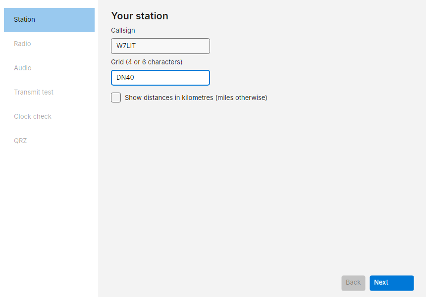
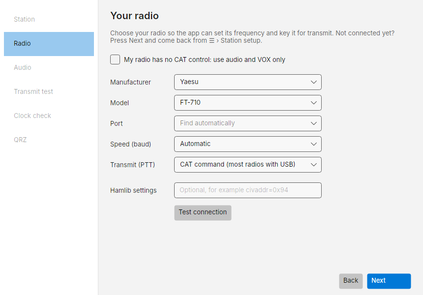
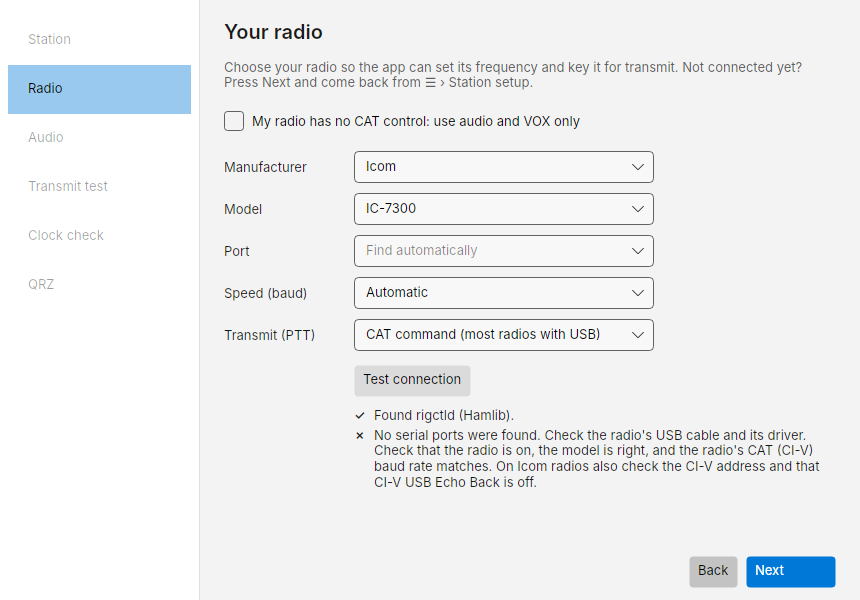
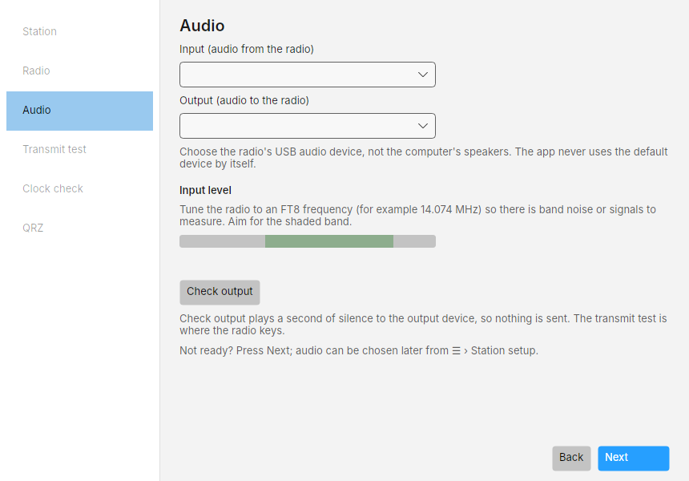
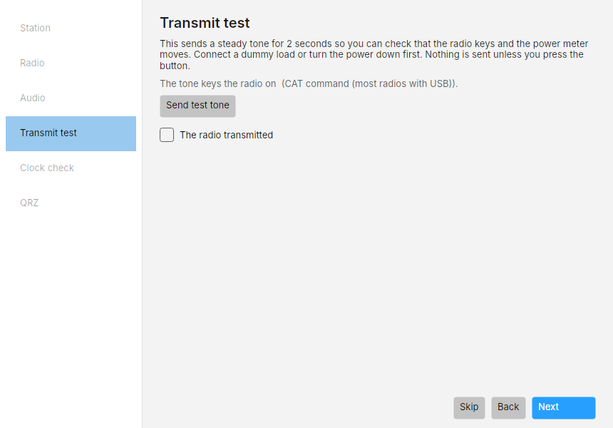
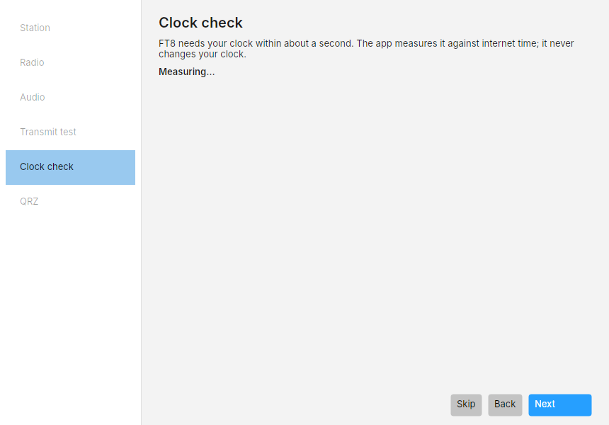
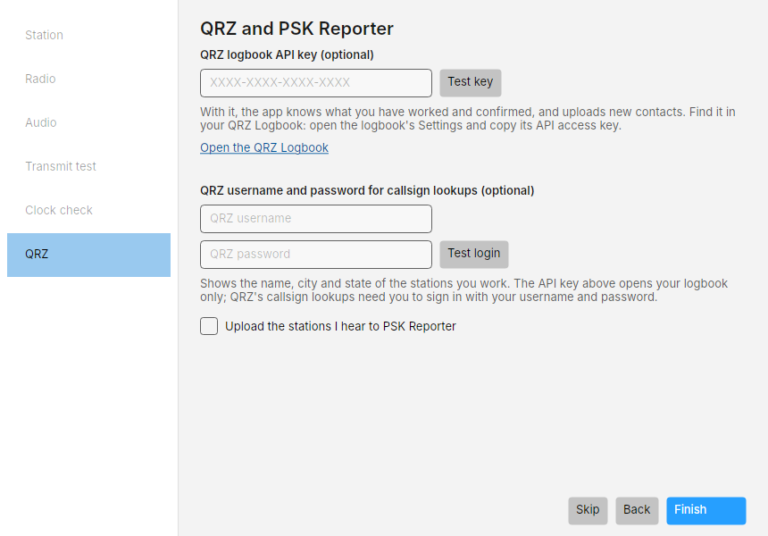

# First-run setup

The first time Costas starts it opens **Set up Costas**: six steps listed down the left. Every step can be skipped
with **Next** and revisited later from the menu (**☰ › Station setup**), so you can start receiving before
everything is connected.

Before you start, have the radio on, connected to the PC by USB, and tuned to an FT8 frequency such as 14.074 MHz
(USB or USB-D mode).

## 1. Station

- **Callsign**: your call, as you send it on the air.
- **Grid**: your Maidenhead locator, 4 or 6 characters (for example `DN40` or `DN40dd`). It is sent in your
  messages and used to work out distance and bearing and to centre the maps.
- **Show distances in kilometres**: miles otherwise.

The step passes when both the callsign and grid are valid.

## 2. Radio (CAT and PTT)

Costas controls the radio through Hamlib, the same library WSJT-X uses.

| Field | What to choose |
| --- | --- |
| **Manufacturer** and **Model** | Your radio, from Hamlib's list (for example Icom › IC-7300) |
| **Port** | The radio's COM port. Leave it on **Find automatically** and Costas tries each port |
| **Speed (baud)** | **Automatic** tries the common rates. Or pick the rate set in the radio's menu |
| **Transmit (PTT)** | How the radio is keyed, below |

If Hamlib Launcher or another program already runs rigctld, choose **Hamlib › NET rigctl**.
Enter its listening address in **Server (host:port)**, for example `127.0.0.1:4532` for a server
on this PC. Keep the launcher running: it owns the radio's COM port and sets the radio model
and baud rate. Costas connects over TCP, so it does not check or scan COM ports or baud rates.

If flrig controls the radio, choose **FLRig** as both the manufacturer and the model, then enter flrig's XML-RPC address in
**Flrig server (host:port)**. Costas fills in flrig's default, `127.0.0.1:12345`; change it when flrig
runs on another PC or listens on another port (flrig's *Config › Setup › Server* page shows both).
Keep flrig running: it owns the radio's COM port. TRXManager and ACLog work the same way.

PTT choices:

- **CAT command (most radios with USB)**: Costas tells the radio to transmit over the same cable. Use this for an
  IC-7300, IC-705, FT-991A, TS-590 and most modern radios.
- **RTS line on a serial port** or **DTR line on a serial port**: for interfaces that key with a serial control line.
- **VOX (the radio keys on audio)**: the radio keys itself when audio arrives. Turn VOX on in the radio.

Press **Test connection**. Costas checks each part in turn and shows a ✓ or ✗ line for each, with what to fix:

When it works you see the radio's dial frequency and mode read back, for example
*The radio answered: 14.074.000 MHz USB-D*. **Test connection never keys the radio.** Keying is checked in step 4.

If you press **Next** with the port still on **Find automatically**, Costas runs the test for you first, because a
radio with no port cannot be opened. If it still cannot find the radio, the results stay on screen; press **Next**
again to carry on and set the radio up later.

!!! tip "Close other radio programs first"
    Only one program can use a COM port at a time. If WSJT-X, JTDX, Flrig, N1MM+ or the radio maker's own utility is
    running, close it before you test. When Costas searches every port it names any port another program is holding.
    The exception is a program you chose as the radio (flrig, or a rigctld server for NET rigctl): keep that one running.

**No CAT cable?** Tick **My radio has no CAT control: use audio and VOX only**. Costas then cannot read or set the
frequency, and keys the radio by VOX. Set the radio to the right frequency yourself.

## 3. Audio

- **Input (audio from the radio)**: the radio's USB audio device, usually named *USB Audio CODEC* or after the radio.
- **Output (audio to the radio)**: the same device's output.

Choose the radio's device, not the computer's speakers or microphone. Costas never picks the Windows default
device by itself.

Once you choose an input, the **Input level** meter moves. Aim for the shaded band (about -40 to -10 dBFS) with the
radio on a busy FT8 frequency. The text beside it tells you what it sees:

| Message | What to do |
| --- | --- |
| No audio is arriving from this device | It may be unplugged, or another program has it in exclusive mode |
| The device sends only silence | Wrong device, or the radio's USB audio output level is at zero |
| Too quiet | Turn up the radio's USB audio output level, or the Windows recording level |
| Too loud / Clipping | Turn either of those down |
| Good level | Hold it there for 5 seconds and the input passes |

**Check output** plays one second of silence to the output device to prove it opens. Nothing goes on the air.

## 4. Transmit test

!!! danger "This step transmits"
    Connect a dummy load or turn the power right down, and make sure the frequency is clear.

**Send test tone** keys the radio and sends a steady 1500 Hz tone for 2 seconds. Watch the radio's TX light and
power meter. Afterwards Costas shows whether the radio reported transmitting, and the ALC and SWR it read during
the tone, with a warning if either is high. Tick **The radio transmitted** if it did. You can skip this step.

With **Settings › Transmitting › Adjust automatically from the radio's ALC** on (the default), Costas uses the ALC
from this tone and every later transmission to set its own audio level, so you do not need to adjust it. With it off,
if ALC moves a lot, lower **Settings › Transmitting › Audio level** or the radio's USB audio input level until it
barely moves.

## 5. Clock check

FT8 needs your PC clock within about a second of UTC. Costas measures the offset against internet time. It never
changes your clock. Under 0.5 s is fine. If it is off, open **Windows Settings › Time & language › Date & time** and
press **Sync now**. Offline is fine too: once decodes arrive, Costas estimates the offset from them.

Transmitting is blocked while the clock is off by more than 2 seconds (the limit can be changed in
**Settings › Transmitting › Clock limit**).

## 6. QRZ and PSK Reporter

All optional. QRZ has two separate services with two separate sign-ins:

- **QRZ logbook API key**: lets Costas read what you have worked and confirmed (so it knows what you need), and
  upload new contacts. Find it on qrz.com: open your Logbook, then its **Settings**, and copy the **API access key**.
  Press **Test key**.
- **QRZ username and password**: used only for callsign lookups (name, city, state, grid of other stations). The API
  key cannot do lookups. Full details need a QRZ XML subscription; without one QRZ returns fewer fields. Press
  **Test login**.
- **Upload the stations I hear to PSK Reporter**: shares your reception reports with other operators.

Your key and password are stored in Windows Credential Manager, never in a settings file or log.

Press **Finish**. If a logbook key was given, the first sync with QRZ starts and shows a progress count.

## After setup

The main window opens on [the Operate screen](operate.md). Within a slot or two you should see decodes. The bottom
right shows **Radio**, **Audio**, **QRZ** and **PSK Reporter** indicators: green for working, with a word for each.
Click any of them to open Diagnostics.
