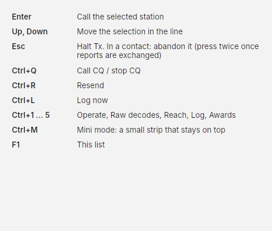

# Keyboard shortcuts

In FT8 and FT4, press ++f1++ in Costas to see this list. In PSK31, PSK63 and RTTY ++f1++ sends your CQ macro, so open
the list from **☰ › Keyboard shortcuts** instead.

| Key | Action |
| --- | --- |
| ++enter++ | Call the selected station (does nothing during a contact) |
| ++up++, ++down++ | Move the selection in Next in line |
| ++esc++ | Halt Tx. In a contact: abandon it. Once reports are exchanged, the first press only stops transmitting and keeps listening; press again to abandon. With a list or menu open, Esc only closes it (and halts if you are transmitting) |
| ++ctrl+q++ | Call CQ / Stop CQ |
| ++ctrl+r++ | Resend |
| ++ctrl+l++ | Log now |
| ++ctrl+1++ to ++ctrl+5++ | Operate, Raw decodes, Reach, Log, [Awards](awards.md) |
| ++ctrl+m++ | [Mini mode](operate.md#mini-mode): a small strip that stays on top |
| ++f1++ | This list |

## PSK31, PSK63 and RTTY

On the Operate screen, typing always goes to the typing line under the conversation, wherever you last clicked.

| Key | While receiving | While sending |
| --- | --- | --- |
| Typing, ++space++, ++backspace++ | Edit the typing line | Go out as you type; Backspace takes back what has not gone |
| ++enter++ | Send what you typed, or the next step's macro | A new line; on an empty line, back to receive |
| ++f1++ to ++f12++ | Send that macro | Add that macro to what is going out |
| ++esc++ | Abandon the contact | Stop sending; press again to abandon the contact |

See [PSK31, PSK63 and RTTY](keyboard-modes.md#making-a-contact).

{ width="460" }
