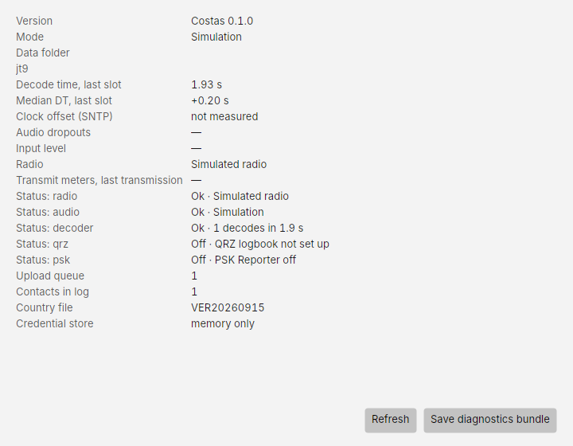
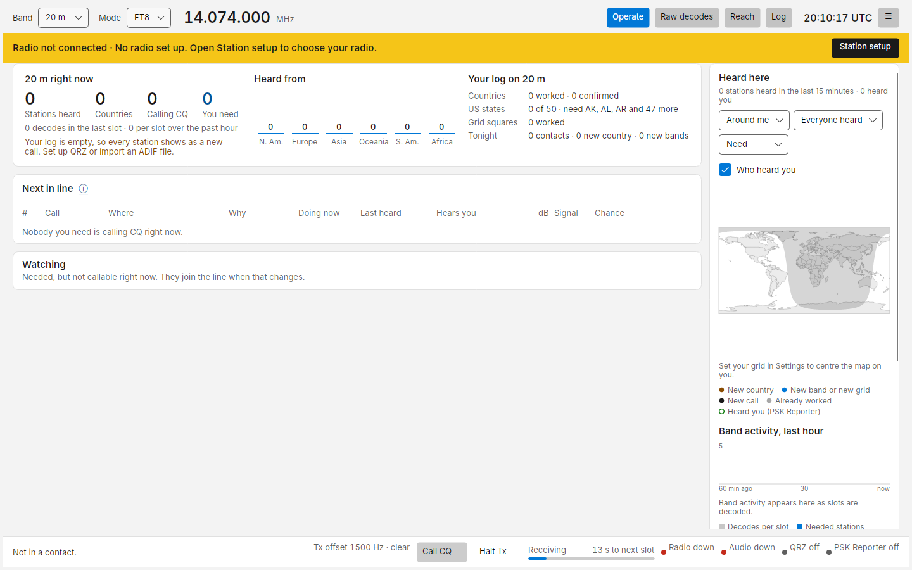

# Troubleshooting

Start with the four indicators at the bottom right (**Radio**, **Audio**, **QRZ**, **PSK Reporter**). Hover for the
detail; click to open **Diagnostics**.

## Diagnostics

**☰ › Diagnostics** shows what Costas is doing right now: version, data folder, the decoder in use, decode time and
median DT of the last slot, clock offset, audio dropouts, input level, the radio and its last transmit meters, the
state of each service, the QRZ upload queue and the country file version.

**jt9 runs** says how the decoder runs. Normally it stays running between slots. If it says *jt9 starts for each
slot*, the reason follows: usually a `jt9` from a WSJT-X version other than 2.7 or 3.0, which Costas cannot feed
directly. Decoding still works then, but portable calls show as `<...>`, decodes arrive later and SuperFox signals
are not decoded. Use the `jt9` that comes with Costas (clear **jt9 decoder** in [Settings](settings.md)) to fix it.
**jt9 starts** counts how often the decoder was started; more than two means it keeps stopping.

**Save diagnostics bundle** writes a zip of the logs and settings, with your QRZ key and password removed. Attach
it when you report a problem on [GitHub Issues](https://github.com/somedudenamedtony/costas/issues).

## The radio

### "Radio not connected · No radio set up"

Costas has no radio configured, so it receives nothing and refuses to transmit. Click **Station setup** in the
banner and go through the [Radio step](setup.md#2-radio-cat-and-ptt).

### The radio was switched off while Costas was open

Many radios (the FT-710, FT-991A, IC-7300 and others) take their USB audio and serial port with them when they are
switched off. Costas shows **Radio** and **Audio** red, and may say "The audio output stopped (The audio device has been
disconnected…)". Leave Costas open and switch the radio back on: within about 15 seconds of Windows finding the radio
again, Costas reopens the audio input and output and reconnects to the radio by itself, and the message goes away.
This also works when Costas was started with the radio off. Nothing is sent when the radio comes back.

If it does not come back, the radio may now be on a different USB socket or COM port (Windows gives it a new name):
open **Station setup** and pick the radio's devices again.

### Test connection says "No serial ports were found"

Windows does not see the radio's USB serial port. Check the USB cable, that the radio is on, and that the radio's USB
driver is installed (for Icom, the *Icom USB driver*; for Yaesu, the *Virtual COM port driver*). In Windows Device
Manager the radio should appear under **Ports (COM & LPT)**.

### Test connection says "No answer from the radio"

The port opens but the radio does not reply.

- Check the **Model** is right.
- Set **Speed (baud)** to match the radio's CAT/CI-V baud rate menu, or leave it on **Automatic**.
- Icom: **CI-V USB Echo Back** must be **OFF**. If the radio's CI-V address is not the model's default, enter it in
  **Hamlib settings**, for example `civaddr=0x94`.
- Close any other program that uses the port: WSJT-X, JTDX, Flrig, N1MM+, the radio maker's utility. Only one
  program can open a COM port.

### The radio does not key, or keys but sends nothing

Use [Station setup › Transmit test](setup.md#4-transmit-test) into a dummy load:

- **No TX at all**: check **Transmit (PTT)**. Most USB radios want **CAT command**. If your interface keys with a
  serial line, choose **RTS** or **DTR**. With **VOX**, VOX must be on in the radio.
- **TX light on, no power out**: the audio is not reaching the radio. Check **Output (audio to the radio)** is the
  radio's USB audio device. Set the radio's data mode input to USB (on an IC-7300: *DATA MOD* = *USB*) and use USB-D
  mode.
- **"The radio cannot report whether it transmitted"**: some radios do not report PTT state over CAT. Watch the TX
  light instead.

### SWR or ALC warning after a transmission

The meters in the bottom bar (or on an instrument skin's faceplate) show SWR in orange or red, or ALC as *High*. Hover
for advice.

- **SWR 2 or more**: check the antenna and tuner. At 3 or more, fix it before sending again.
- **ALC 50% or more**: the audio is overdriving the radio and the signal will be distorted. With automatic
  level on, Costas has already lowered its level for the next transmission and the advice says by how much; it
  settles within a few transmissions. With it off, lower **Settings › Transmitting › Audio level** or the radio's USB
  audio input level until ALC barely moves.

### Automatic level keeps rising but ALC never moves

Automatic level stops 6 dB above the level you typed in Settings. If ALC still reads nothing there, the audio may not
be reaching the radio: check the audio output device in Station setup, that the radio takes its transmit audio from
USB in data mode, and the radio's USB audio input level. The app log notes when the level reaches its highest.

### The radio keys but sends no audio (no power out)

Look at **Settings › Transmitting › Audio level**. If it reads -40 dB or close to it, automatic level was walked down by a
fault in versions before 0.1.0.336 that sometimes read the SWR meter as ALC. Later versions clear such levels when
they start; you can also type your usual level (for example -6) there and press Save. If the level looks normal, check the
audio output device in Station setup and that the radio takes its transmit audio from USB in data mode.

## Receiving

### No decodes

1. Check **Audio** is green and the input is the radio's USB audio device (Station setup › Audio). The input meter
   should sit in the shaded band.
2. Check the radio is on an FT8 frequency (14.074 MHz on 20 m) in USB or USB-D, with a wide enough filter (about
   3 kHz).
3. Check your clock. **Raw decodes › DT** should be near 0. If decodes appear but DT is large, or nothing decodes on
   a busy band, sync the Windows clock (**Settings › Time & language › Date & time › Sync now**).
4. If another program has the audio device in exclusive mode, close it. In Windows sound settings you can also untick
   *Allow applications to take exclusive control of this device* for the radio's device.

### The status line says the receive audio is silent or clipping

Costas keeps an ear on the radio's audio while it runs. When something is clearly wrong for half a minute of receiving
(time spent transmitting does not count), the status line says so in amber:

| Message | Cause and fix |
| --- | --- |
| *No audio is arriving from the radio's sound device* | The USB cable came loose, the radio or PC went to sleep, or another program took the device. Check the cable and the radio; Costas reopens the device when it comes back |
| *The radio's sound device sends only silence* | The radio's USB audio output is turned down to zero or muted, or Windows muted the recording device |
| *The receive audio is clipping* | The audio is too loud and being cut off, which costs decodes. Turn down the radio's USB audio output level or the Windows recording level until the Setup input meter sits in the shaded band |

The message goes away by itself five seconds after the audio is good again. A quiet band is not reported.

### Everyone shows as "New call"

Costas does not know your log yet. Add your QRZ logbook API key in [Settings › QRZ](settings.md#qrz) and press
**Sync with QRZ now** in the Log view, or import an ADIF file from your previous logger.

## Transmitting is refused

| Message | Cause and fix |
| --- | --- |
| *Your clock is off by 2.4 s. Transmitting is blocked above 2 s.* | Sync the Windows clock. With **Clock correction** on, Costas fixes this itself once a time server answers; if it cannot reach one, or the clock is off by more than a minute, it can't. The limit is in Settings › Transmitting › Clock limit |
| *Stopped by watchdog* | You had not touched the app for 6 minutes (3 from the phone). Any contact being answered was finished first. Click Call or Call CQ again |
| *… is outside the US data segments on 20 m* | US rules allow FT8 only in part of each band (below 14.150 MHz on 20 m, 7.125 MHz on 40 m, 3.600 MHz on 80 m, and so on). Tune back to an FT8 frequency. Licensed outside the US? Turn off **Settings › Transmitting › US data segments only** |
| *… cannot be sent …* | The message cannot be encoded exactly as shown, for example a callsign or free text FT8 cannot carry. Costas never changes a message silently; shorten or change it |
| No radio set up | See *Radio not connected* above |

## QRZ

| Problem | Fix |
| --- | --- |
| *The QRZ logbook key was refused* | Copy the API key again from your QRZ Logbook's Settings. It belongs to one logbook; check it is the logbook for your current callsign |
| Names and locations never appear | Lookups need your QRZ **username and password**, not the API key. Full details need a QRZ XML subscription |
| *Upload failed · Retry* | Click **Retry** in Worked tonight. *Waiting to upload · retrying* means Costas is still retrying by itself |
| *QRZ refused the contact* | Diagnostics shows the reason QRZ gave. A contact already in your QRZ logbook is one common cause |

Costas works fine without QRZ: the list then ranks by signal only.

## eQSL

**Sync inbox now / test login** in Settings › eQSL shows what eQSL itself answered, in quotes.

| Problem | Fix |
| --- | --- |
| *eQSL said "Error: No such Username/Password found"* | The username is your eQSL callsign. Check it and the password by signing in at eqsl.cc |
| *eQSL said "Error: No such Callsign found"* | eQSL has no account for that username. Use the callsign your eQSL account is under |
| A message about QTH or multiple accounts | Copy the **QTH nickname** exactly from your eQSL account. It is needed when one callsign has several locations |
| *eQSL: 0 inbox cards* | The login worked and your eQSL inbox is empty |

## PSK Reporter shows "unavailable"

The live feed uses MQTT over TLS on TCP port 1884 (`mqtt.pskreporter.info`). Some networks and firewalls block it.
Costas then falls back to querying PSK Reporter every 5 minutes, shown as *PSK Reporter · updated 6 min ago*. If both fail, Chance comes from the signal alone and
Reach stays empty; everything else still works.

## The status line says "Something went wrong"

Costas hit an error it did not expect, for example from a driver. It stops transmitting as a precaution and keeps
running. Carry on, and if it happens again, save a diagnostics bundle (**☰ › Diagnostics**) and report it as below.

## Windows says "Windows protected your PC"

SmartScreen shows this for programs it does not know, and Costas is not code-signed yet (*Unknown publisher*).
Click **More info**, then **Run anyway**. See [Install](install.md#download).

## Still stuck

Open an issue on [GitHub](https://github.com/somedudenamedtony/costas/issues) with what you did, what you expected,
what happened, your radio model, and the diagnostics bundle.
